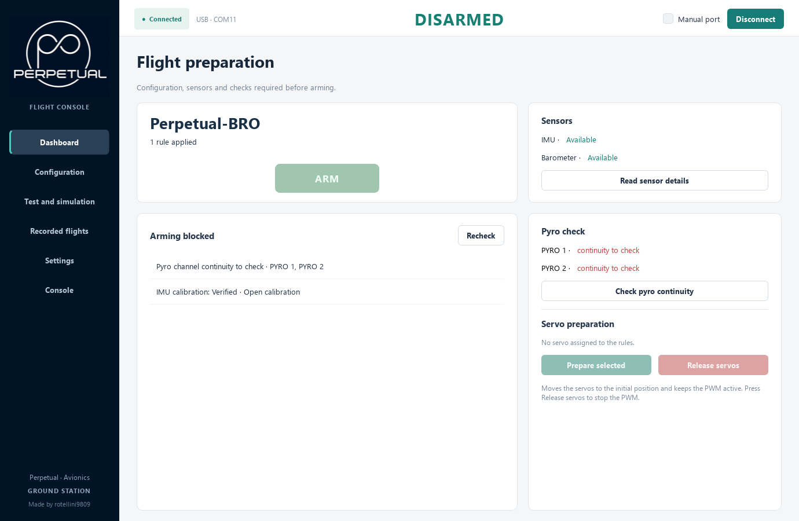
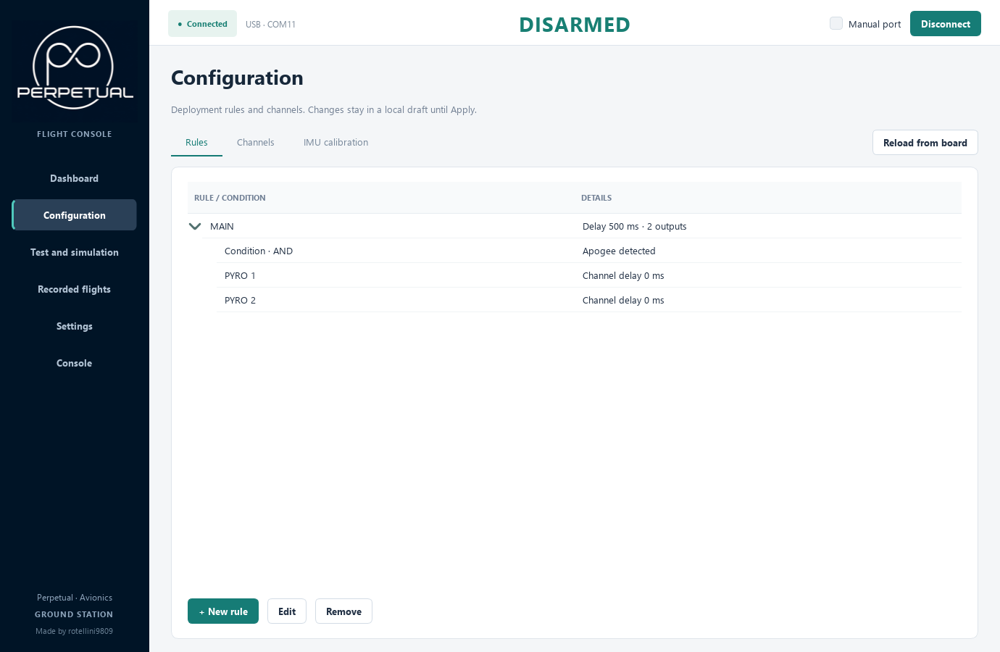
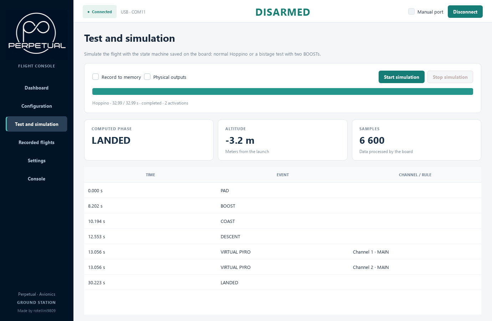
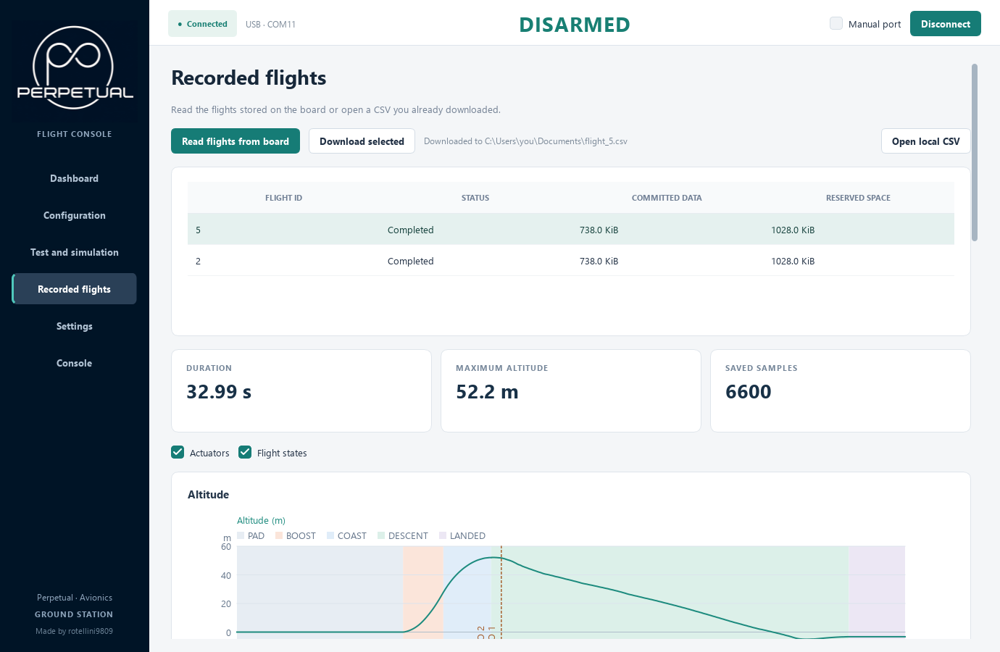
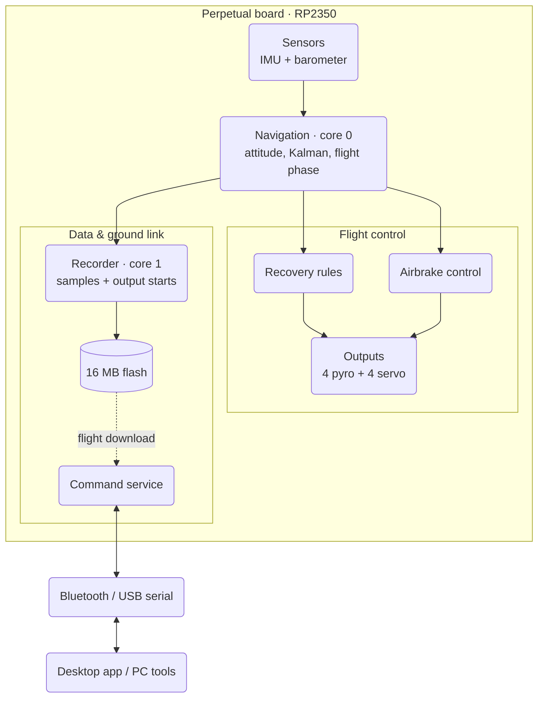

<p align="center">
  
</p>

<h1 align="center">Perpetual — Firmware &amp; Desktop App</h1>

<p align="center">
  Flight computer firmware for the RP2350-based Perpetual avionics board,<br>
  and the desktop app used to configure it, test it and download its flights.
</p>

<p align="center">
  <a href="LICENSE"></a>
  
  
  
</p>

---

> **Part of the Perpetual project**, developed for the
> **Sapienza Rocket Team Training Academy**.
>
> | Repository | Contents |
> |---|---|
> | [Perpetual_training_accademy_avionics](https://github.com/Sapienza-Rocket-Team/Perpetual_training_accademy_avionics) | Main project: overview of the whole system, with the two repositories below as submodules |
> | [perpetual_pcb](https://github.com/rotellini9809/perpetual_pcb) | Hardware: KiCad schematics, PCB layout and fabrication files |
> | **perpetual_code** (this repository) | Firmware and desktop app |

> [!TIP]
> **New to Perpetual?** Flash the board with the [Quick start](#quick-start), then follow the
> **[app guide](docs/APP_GUIDE.md)**: it walks you through preparing a flight, step by step.

> [!WARNING]
> Perpetual drives **pyrotechnic channels** and servo actuators. Bench-test every configuration
> with the outputs disconnected or in simulation first, and follow your team's and range's
> safety rules. This is experimental hobby/academic avionics and is **not certified for any
> use**. What has been verified, and how, is recorded in [Validation](docs/testing/VALIDATION.md).

## Contents

- [Features](#features)
- [Screenshots](#screenshots)
- [Workflow](#workflow)
- [How it works](#how-it-works)
- [Repository layout](#repository-layout)
- [Quick start](#quick-start)
- [Development](#development)
- [Tools](#tools)
- [Documentation](#documentation)
- [Author and license](#author-and-license)

## Features

### Firmware

- **Sensing**: LSM6DSV32X IMU (±32 g, ±2000 °/s) at 480 Hz and BMP581 barometer at 100 Hz,
  read through the IMU FIFO with per-sample timestamps.
- **Navigation**: attitude estimation, vertical Kalman filter and flight phase detection
  (PAD → BOOST → COAST → DESCENT → LANDED), with a configurable board mounting orientation and
  IMU calibration.
- **Single-stage and two-stage flights**: separate state machines, including second-ignition
  detection and tilt/abort protection.
- **Configurable recovery rules**: conditions on phase, altitude, speed and time drive **4 pyro
  channels** and **4 servo channels**, with delays and dependencies between rules. Plans are
  validated on the board before they are applied.
- **Airbrakes**: a continuous servo control interface where you plug in your own control law.
- **Flight recording**: sensor data, estimates and events are logged to the onboard 16 MB flash
  from the second core, so recording never blocks the flight loop. Flights survive power loss
  and are never deleted automatically.
- **USB and Bluetooth**: the same command protocol runs over USB serial and over the JDY-34
  Bluetooth module, and both links can be used at the same time.
- **Simulation and hardware-in-the-loop**: replay a recorded flight on the real board, either
  with simulated outputs or driving the real ones, to test a configuration end to end on the
  ground.
- **Status LED and power saving**: an RGB LED shows the flight phase, and the board powers its
  sensors and flash down after five minutes of inactivity.

### Desktop app

- **Dashboard**: connection, live sensors, battery, preflight checks and arming.
- **Configuration**: build recovery rules, set servo endpoints, board orientation and IMU
  calibration, with the same validation the firmware applies.
- **Test / Simulation**: run on-board simulations and hardware-in-the-loop sessions.
- **Recorded Flights**: download flights to CSV, plot them and review their details.
- **Settings**: Bluetooth name, language, factory reset and memory format. **Console** for raw
  commands.
- Connects over **USB or Bluetooth**, available in **English and Italian**, and can be packaged
  as a portable Windows app that needs no Python installation.

## Screenshots

<table>
  <tr>
    <td></td>
    <td></td>
  </tr>
  <tr>
    <td align="center">Dashboard: preflight checks and arming</td>
    <td align="center">Configuration: recovery rules</td>
  </tr>
  <tr>
    <td></td>
    <td></td>
  </tr>
  <tr>
    <td align="center">On-board simulation</td>
    <td align="center">Recorded flights</td>
  </tr>
</table>

## Workflow

Preparing a flight with the app takes eight steps. The [app guide](docs/APP_GUIDE.md) explains
each one with screenshots.

1. **[Set up the board](docs/APP_GUIDE.md#step-1--set-up-the-board)**: orientation, flight mode
   and Bluetooth name.
2. **[Calibrate the IMU](docs/APP_GUIDE.md#step-2--calibrate-the-imu)** on its six faces.
3. **[Create the recovery rules](docs/APP_GUIDE.md#step-3--create-the-recovery-rules)**: when each
   pyro or servo fires.
4. **[Set the servo positions](docs/APP_GUIDE.md#step-4--set-the-servo-positions)**, if you use
   servos.
5. **[Test with a simulation](docs/APP_GUIDE.md#step-5--test-with-a-simulation)** on the board.
6. **[Check the result](docs/APP_GUIDE.md#step-6--check-the-result)** in the flight plots.
7. **[On the pad](docs/APP_GUIDE.md#step-7--on-the-pad-checks-and-arming)**: preflight checks,
   pyro continuity, servo preparation and ARM.
8. **[After the flight](docs/APP_GUIDE.md#step-8--after-the-flight)**: download the data and look
   at the plots.

## How it works



Real sensors, a hardware-in-the-loop stream from the PC and the on-board simulated flight all
go through the same navigation, rules, output and recording code. What you test on the ground
is the code that flies. For details, see [Architecture](docs/technical/ARCHITECTURE.md).

## Repository layout

| Path | Contents |
|---|---|
| [`src/`](src), [`include/`](include) | Firmware sources, organized by area: `hardware`, `navigation`, `flight`, `configuration`, `control`, `storage`, `communication`, `simulation`, `diagnostics` |
| [`perpetual_app/`](perpetual_app) | Qt desktop app and its Windows packaging scripts |
| [`tools/`](tools) | PC tools: device client, test runner, replay and simulation runners, measurement scripts |
| [`test/`](test) | Host-side C++ tests, Python integration tests and shared fixtures |
| [`datasets/`](datasets) | Reference flight data used for replay and simulation |
| [`docs/`](docs) | Technical documentation, test procedures, validation records and datasheets |
| [`platformio.ini`](platformio.ini) | Firmware build configuration and pinned dependencies |

## Quick start

### Requirements

- A Perpetual board ([hardware](https://github.com/rotellini9809/perpetual_pcb)) and the
  RP2350 Tiny USB-C adapter with its flex cable.
- [VS Code](https://code.visualstudio.com/) with the
  [PlatformIO](https://platformio.org/install/ide?install=vscode) extension, or PlatformIO Core.
- Python 3.13 for the desktop app and the tools. The commands below are for Windows PowerShell.

### 1. Flash the firmware

Connect the board over the flex cable and USB-C adapter, then from the repository root run:

```powershell
pio run -t upload
```

PlatformIO downloads the pinned RP2350 platform, toolchain and libraries the first time. If the
board is not detected, hold **BOOT** while plugging in the USB cable and upload again.

### 2. Talk to the board

Open the serial monitor at 115200 baud (`pio device monitor`) and try `help`, `status`,
`sensors` or `config show`. The board always boots **disarmed** and keeps any configuration
already saved on it. Close the serial monitor before connecting the app, because only one
program can open the port at a time.

### 3. Run the desktop app

```powershell
python -m venv .venv
.\.venv\Scripts\python.exe -m pip install -r perpetual_app/requirements.txt
.\.venv\Scripts\python.exe perpetual_app/main.py
```

The app finds the board by itself: it tries USB first, then Bluetooth, so you never have to pick
a COM port. To connect over Bluetooth, first **pair the board in Windows**
(**Settings → Bluetooth & devices → Add device**). It appears as `Perpetual`, or
`Perpetual-<suffix>` if you renamed it. The app does not pair devices itself.

The app starts in English; you can switch to Italian in **Settings → Language**.

**Next:** follow the [app guide](docs/APP_GUIDE.md) to prepare your first flight.

## Development

### Firmware entry points

[`platformio.ini`](platformio.ini) builds one entry point at a time. Uncomment exactly one
`build_flags` line:

| Flag | Purpose |
|---|---|
| `MAIN` | The flight computer application (default) |
| `SMOKE_TEST`, `SENSOR_TEST` | Basic board bring-up and sensor checks |
| `BLUETOOTH_TEST`, `BLUETOOTH_NAME_TEST` | JDY-34 radio diagnostics |
| `FLASH_TEST`, `FLASH_DIRECTORY_TEST` | Flash memory and flight directory diagnostics |
| `CONFIG_STORE_TEST` | Configuration storage diagnostics |

Firmware dependencies are pinned to exact versions or commits: the RP2350 platform (and with it
the Arduino-Pico framework and toolchain), Adafruit NeoPixel, the Bosch BMP5 driver and the ST
LSM6DSV32X driver. App dependencies are pinned in
[`perpetual_app/requirements.txt`](perpetual_app/requirements.txt).

### Tests

The tests run on the PC and need `g++` and Python. They do not run when you upload firmware.

```powershell
python tools/run_tests.py                     # C++ and client checks
python tools/run_tests.py --full              # also the full recorded-flight replay
python tools/run_tests.py --list              # list the test areas
python tools/run_tests.py --suite bluetooth   # one area only
```

Compiled objects are cached under `.pio/tests`. Add `--rebuild` to force a clean build. See the
[test guide](docs/testing/README.md) for on-board diagnostics.

### Package the desktop app

```powershell
powershell -ExecutionPolicy Bypass -File perpetual_app/build.ps1 -Zip
```

This builds a portable Windows app with PyInstaller:

- `.pio\desktop_dist\Perpetual\Perpetual.exe`: keep the exe next to its `_internal` folder.
- `.pio\desktop_dist\Perpetual-windows-x64.zip`: the same folder, zipped for sharing.

The build is unsigned, so Windows SmartScreen may warn the first time it runs
(**More info → Run anyway**). Add `-SkipInstall` to reuse the dependencies already installed.

## Tools

| Command | What it does |
|---|---|
| `python tools/device_client.py --port COM9 --watch` | Connect and watch the board's replies (Ctrl+C to quit) |
| `python tools/device_client.py --port COM9 --command "config show"` | Send a single command |
| `python tools/replay/replay_sensors_usb.py --port COM9` | Stream a recorded flight's sensor data to the board (hardware-in-the-loop) |
| `python tools/replay/run_simulation_usb.py --port COM9` | Run the built-in simulated flight on the board |
| `python tools/measure_live_sensors.py --port COM9 --output rates.json` | Measure the live sensor sample rates |

Replay and simulation use virtual outputs by default. Add `--record` to also save the run to
flash. The reference flight used by
default is [`datasets/hoppino_VOLO_UFFICIALE.csv`](datasets/hoppino_VOLO_UFFICIALE.csv). See
[Simulation and replay](docs/testing/SIMULATION.md) and
[Recording and download](docs/testing/RECORDING.md).

## Documentation

Start from the [documentation map](docs/README.md). To learn the desktop app, read the
[app guide](docs/APP_GUIDE.md).

**Technical reference**

- [Architecture](docs/technical/ARCHITECTURE.md): source layout and runtime path
- [Flight state machines](docs/technical/STATE_MACHINES.md): single-stage and two-stage
- [Navigation and calibration](docs/technical/NAVIGATION.md)
- [Configuration and recovery rules](docs/technical/CONFIGURATION.md)
- [Airbrakes](docs/technical/AIRBRAKES.md)
- [Storage behavior](docs/technical/STORAGE.md) and [binary formats](docs/technical/STORAGE_FORMAT.md)
- [USB / Bluetooth protocol](docs/technical/USB.md)
- [Desktop app](docs/technical/DESKTOP.md)
- [Hardware, pinout and datasheets](docs/HARDWARE.md)

**Testing and validation**

- [Test guide and on-board diagnostics](docs/testing/README.md)
- [Simulation and replay](docs/testing/SIMULATION.md)
- [Recording, download and timing](docs/testing/RECORDING.md)
- [Validation records](docs/testing/VALIDATION.md)

## Author and license

Firmware, desktop app and [hardware](https://github.com/rotellini9809/perpetual_pcb) designed by
**Simone Cargnin** ([@rotellini9809](https://github.com/rotellini9809)) for the
**Sapienza Rocket Team Training Academy**.

The original software in this repository is licensed under the
[PolyForm Noncommercial License 1.0.0](LICENSE). See [NOTICE](NOTICE) for the required
attribution. Third-party components keep their own licenses.

For commercial licensing, contact rotellini9809@gmail.com.

If you use Perpetual in research, please let me know at the address above. This is a voluntary
request, not a license condition.
