# Perpetual app guide

This guide walks you through the Perpetual desktop app, from setting up a new board to reading
back a flight. Follow the [workflow](#preparing-a-flight-step-by-step) in order the first time; later
you can jump straight to the step you need.

> [!NOTE]
> **Before you start**: the board must be running the Perpetual firmware and the app must be
> connected to it. If it isn't, follow the [Quick start](../README.md#quick-start) in the main
> README first.

> [!WARNING]
> Never connect igniters or energetics while you are learning the app or testing a
> configuration. Use simulations with virtual outputs until you are on the pad.

## Contents

- [The interface at a glance](#the-interface-at-a-glance)
- [Preparing a flight, step by step](#preparing-a-flight-step-by-step)
  1. [Set up the board](#step-1--set-up-the-board)
  2. [Calibrate the IMU](#step-2--calibrate-the-imu)
  3. [Create the recovery rules](#step-3--create-the-recovery-rules)
  4. [Set the servo positions](#step-4--set-the-servo-positions)
  5. [Test with a simulation](#step-5--test-with-a-simulation)
  6. [Check the result](#step-6--check-the-result)
  7. [On the pad: checks and arming](#step-7--on-the-pad-checks-and-arming)
  8. [After the flight](#step-8--after-the-flight)
- [Other tools](#other-tools)
- [Good to know](#good-to-know)
- [Troubleshooting](#troubleshooting)

## The interface at a glance

  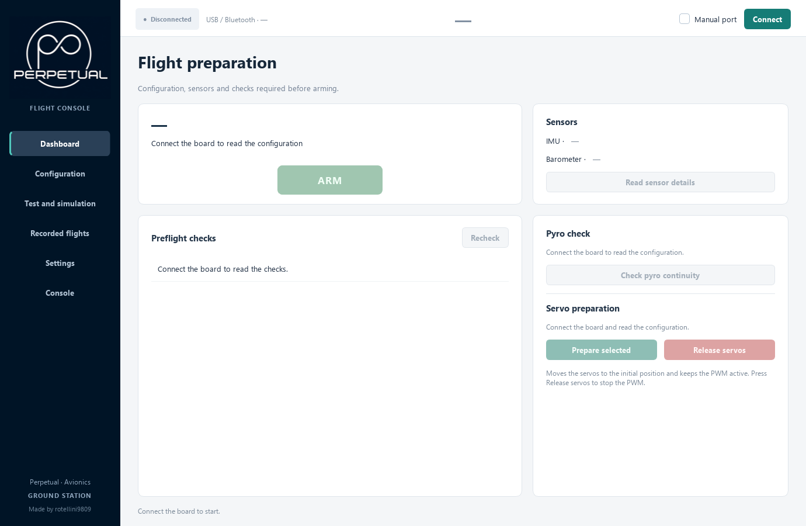

**Connection bar** (top), from left to right:

- **Connection status**, with the link in use (`USB · COM11`, `Bluetooth · COM6`).
- **Arming state**: a large **DISARMED** (green) or **ARMED** (red), always as reported by the board.
- **Connect / Disconnect**. The app searches for the board by itself, first over USB and then over
  Bluetooth. **Manual port** lets you pick a specific port instead; you rarely need it.

**Sidebar** pages:

| Page | What you do there |
|---|---|
| **Dashboard** | Check the board before flight: sensors, preflight checks, pyro continuity, servo preparation and **ARM** |
| **Configuration** | Recovery rules, output channels and IMU calibration |
| **Test and simulation** | Fly a simulated flight on the board to test your configuration |
| **Recorded flights** | Download flights from the board and look at the plots |
| **Settings** | Board orientation, flight mode, airbrakes, Bluetooth name, language, reset and memory format |
| **Console** | Send commands by hand and read the board's raw replies |

Messages and errors appear in a line at the bottom of the window.

## Preparing a flight, step by step

### Step 1 — Set up the board

Open **Settings**. Each card has its own **Save** button, and nothing is sent to the board until
you press it. These settings stay saved on the board, so you only redo them when the rocket changes.

**Board orientation.** Choose the sensor axis that points toward the **rocket nose** as the board
is mounted, then press **Save orientation**. The picture shows the board axes for reference.

  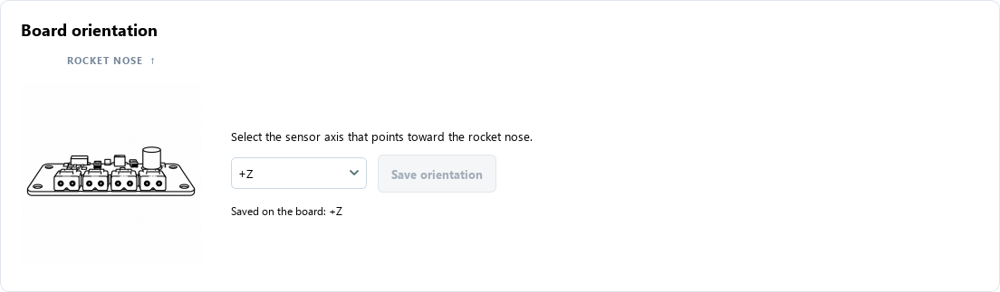

**State machine.** The normal flight goes PAD → BOOST → COAST → DESCENT → LANDED. For a two-stage
rocket, tick **Enable bistage flight** and set the minimum vertical speed the rocket must keep after
the first burn. If that check fails, or the rocket tilts more than 40° during the first coast, the
flight goes to **ABORT**: no new outputs are started.

  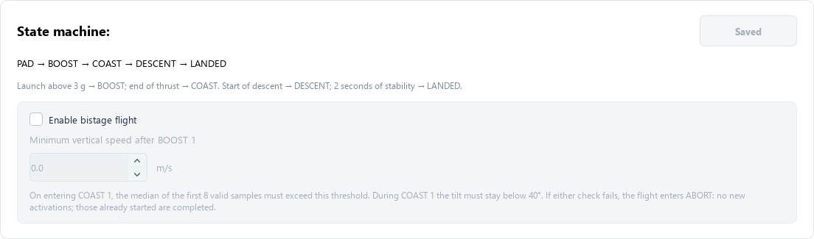

**Airbrakes.** Leave this off unless your firmware includes an airbrake control law. Enabling it
alone does not open anything: the default law keeps the airbrakes closed.

  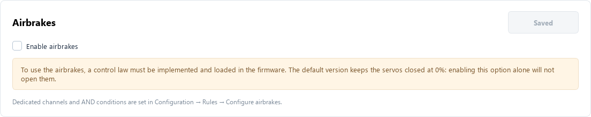

**Bluetooth name.** If your team has several boards, give each one a short suffix (up to 4 letters,
digits or `-`): the board becomes `Perpetual-<suffix>`. The Bluetooth module restarts to apply the
name; the app reconnects by itself. Windows keeps showing the old name until you remove the device
and pair it again.

  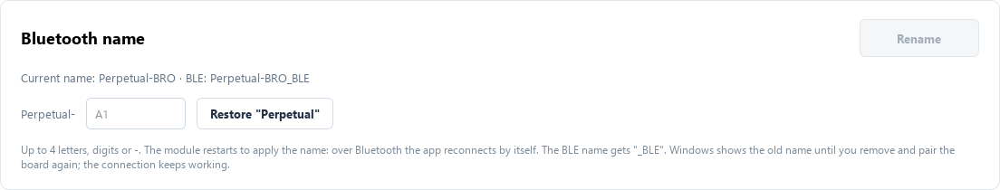

### Step 2 — Calibrate the IMU

Go to **Configuration → IMU calibration**. The calibration measures the accelerometer's offset
and scale. Do it once per board, and repeat the verification when the app asks for it, for example
after a flight.

  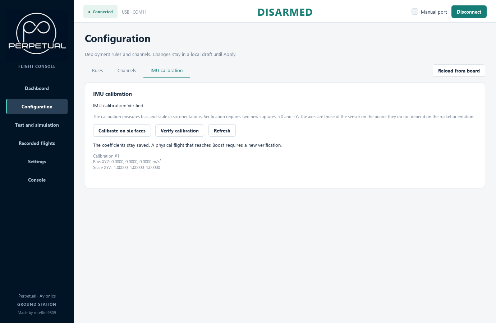

1. Press **Calibrate on six faces**.
2. The app shows which face to point up (`+X`, `-X`, `+Y`, `-Y`, `+Z`, `-Z`) with a picture of
   the board; the faces already captured turn green. These are the axes printed on the board, not
   the rocket's.
3. Rest the board with that face pointing straight up (within about 2°: use a stand or a square
   block), keep it still and press **Capture**. Wait for the progress bar to fill and turn green.
4. Repeat for all six faces. If the board moves, is not in position or the reading is noisy, the
   capture stops and the bar turns ochre: put the face back up, keep the board still and press
   **Capture** again.

**Verify calibration** turns green when a verification is due. It asks for three new captures (`+X`, `+Y` and `+Z`) to check the saved values;
here each face only needs to point roughly up (within 10°), so leaning the board on something is fine. After a
real flight the board asks for this verification again before it can be armed.

### Step 3 — Create the recovery rules

Rules decide **when** each output fires. Go to **Configuration → Rules**.

  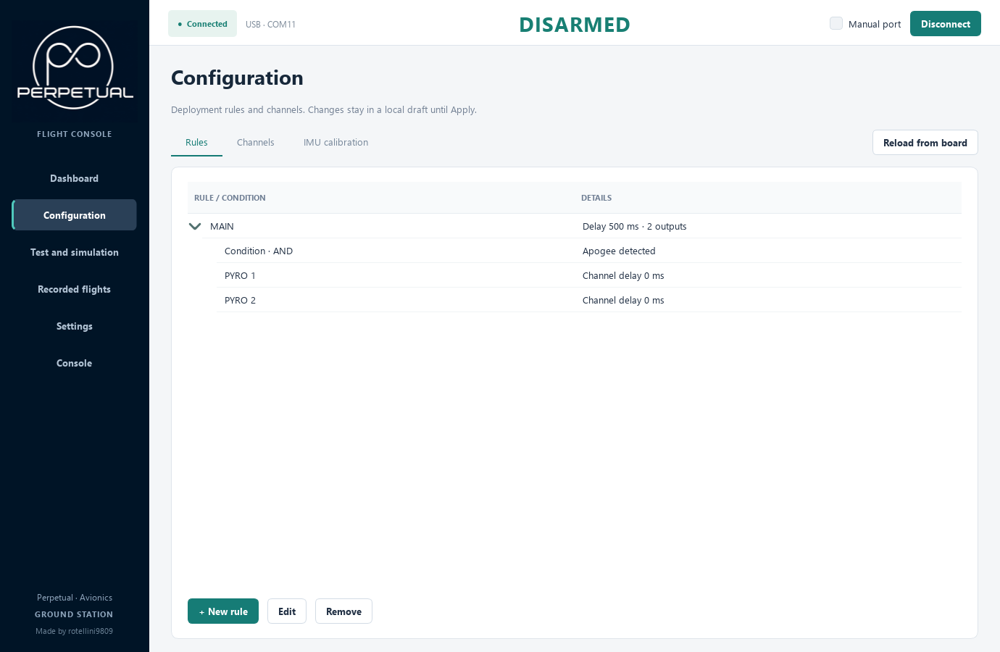

Your changes are kept in a **local draft** in the app. Nothing reaches the board until you press
**Validate** and then **Apply** in the bar that appears at the bottom of the page. **Discard** drops
the draft.

Press **+ New rule**, or select a rule and press **Edit**:

  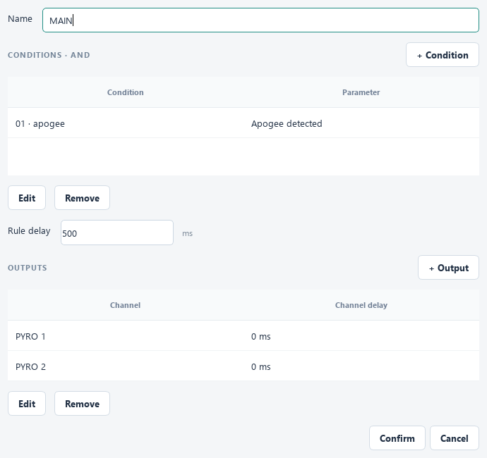

- **Name**: anything that helps you recognize the rule, for example `DROGUE` or `MAIN`.
- **Conditions**: **all** of them must be true for the rule to start. Add them with **+ Condition**:

  

    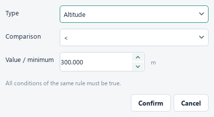
  

  | Condition | Meaning |
  |---|---|
  | Flight phase | The rocket is in one of the selected phases (BOOST, COAST, DESCENT…) |
  | Apogee detected | The board has detected the apogee |
  | Altitude / Altitude range | Altitude above the launch point, in metres |
  | Absolute vertical speed / Speed range | Vertical speed, up or down, in m/s |
  | Time since launch / since apogee | Time elapsed since that event |
  | Time since a rule | Time elapsed since another rule started, to chain events |

- **Rule delay**: how long to wait after the conditions first become true. The conditions do not
  need to stay true during the wait.
- **Outputs**: the pyro or servo channels the rule drives. Each output can add its own **channel
  delay**, on top of the rule delay. A channel can belong to only one rule.

  

    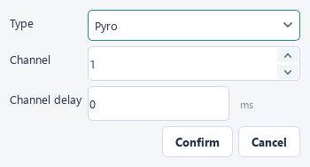
  

Pyro channels always fire a fixed 1-second pulse. You can have up to 8 rules.

> [!TIP]
> A typical dual-deploy setup is two rules: **DROGUE** on *Apogee detected* driving PYRO 1, and
> **MAIN** on *Flight phase = DESCENT* AND *Altitude < 300 m* driving PYRO 2.

When you are done, press **Validate**. The board checks the draft and reports the first problem if
there is one. Then press **Apply** to save it to the board.

### Step 4 — Set the servo positions

Skip this step if your rules only use pyro channels.

**Configuration → Channels** lists all eight outputs and which rule each one belongs to. A servo used
by a rule shows **Configure**: open it to set the two positions the servo moves between.

  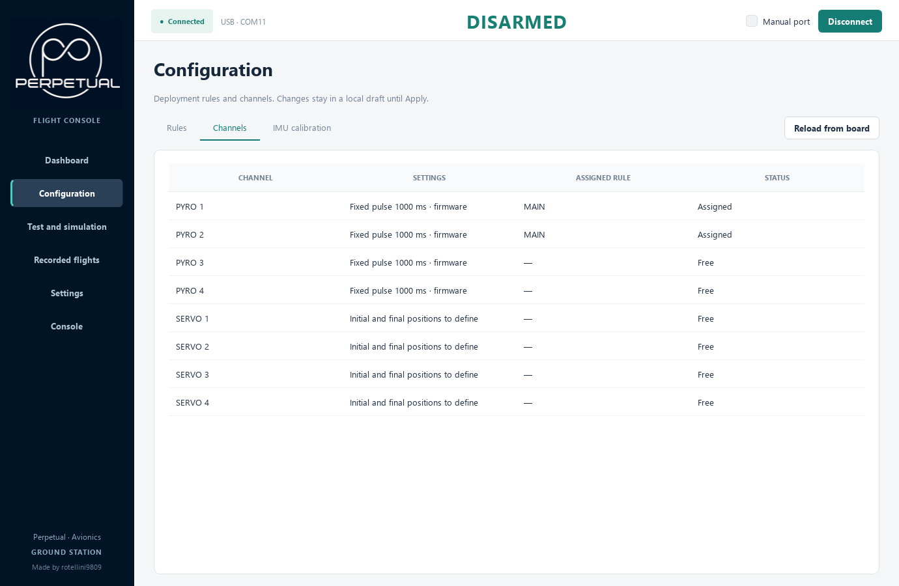

  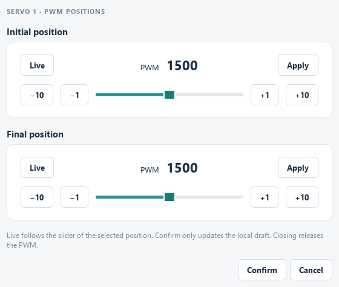

- Move the slider, or use **−10 / −1 / +1 / +10**, to set the **Initial** and **Final** positions.
- **Apply** moves the servo to that position once. **Live** makes the servo follow the slider while
  you drag it, which helps you find the exact end points on the real mechanism.
- **Confirm** saves that servo's positions to the board straight away. Any other unsaved change (for
  example a rule you are editing) stays in the draft until you **Apply** it.

The board refuses to arm while a servo used by a rule has no positions set.

### Step 5 — Test with a simulation

**Test and simulation** flies a recorded flight (or, in bistage mode, a two-stage test profile)
through the board's real navigation and rules, so you can check that your rules fire when you expect.

  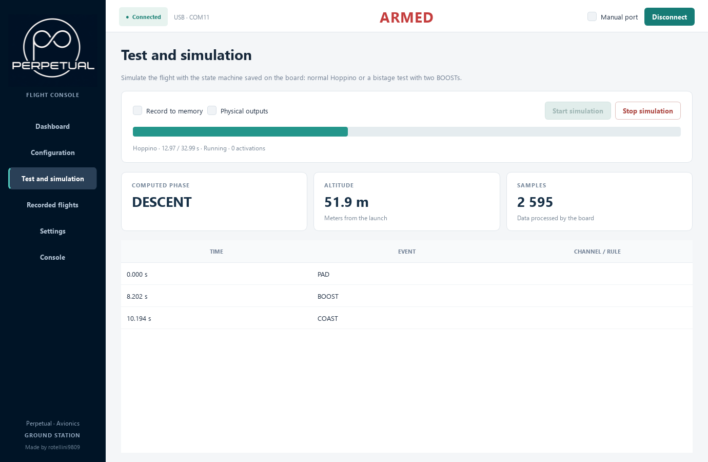

1. Leave **Physical outputs** unticked: outputs are only simulated (`VIRTUAL PYRO` in the table).
2. Tick **Record to memory** if you want to keep the run as a flight you can open later in
   Recorded flights.
3. Press **Start simulation**. The board shows the phase, the altitude and every event as it happens.

  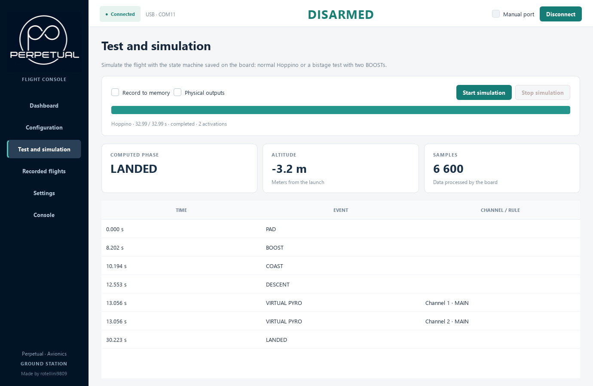

Check the event list: each output should start at the time and in the phase you planned.

> [!CAUTION]
> **Physical outputs** really fires the pyro channels and moves the servos during the simulation.
> Use it only on the bench, with nothing energetic connected, to check wiring and servo movement.

### Step 6 — Check the result

If you recorded the simulation, open **Recorded flights**, press **Read flights from board**, select
the flight and press **Download selected**. The app saves a CSV file and a JSON file, and opens the
flight.

  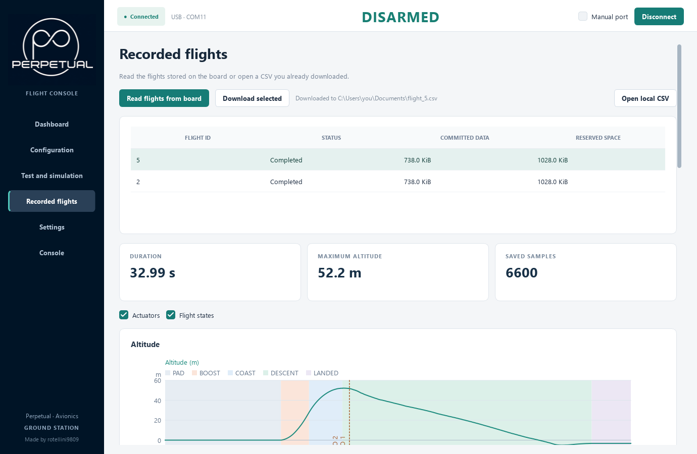

The plots show the flight phases as coloured bands and each output as a dashed line. Use the
**Actuators** and **Flight states** boxes to hide them. Hover over a plot to read the exact values.

  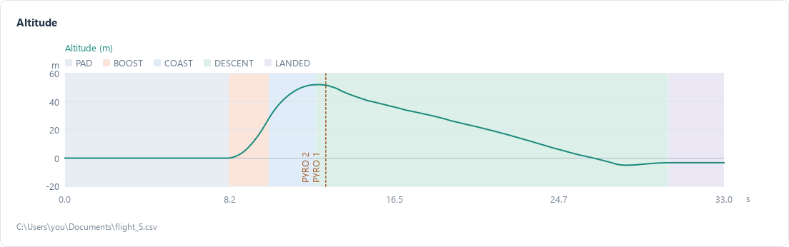

  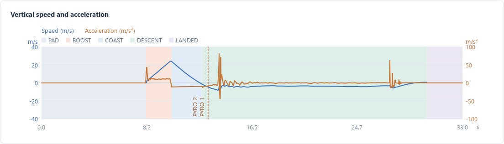

Further down you find the angular rates, the orientation and the battery voltage:

<table>
  <tr>
    <td>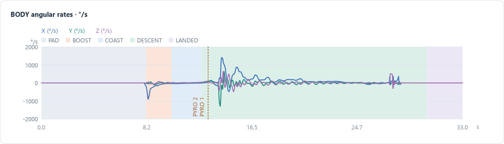</td>
    <td>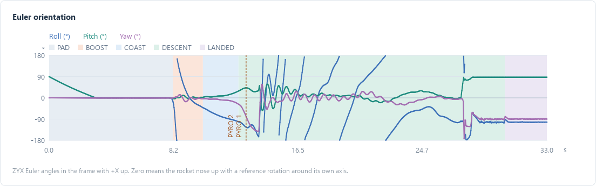</td>
  </tr>
</table>

At the bottom, the **Flight data** table lists the flight type (real or simulated), the calibration
used, the rules saved with the flight and how many of them fired.

  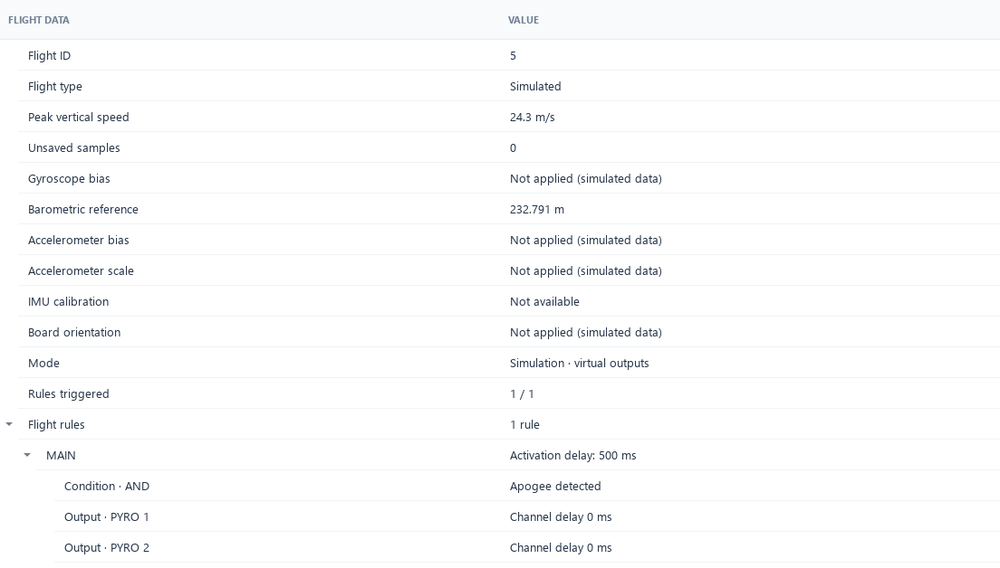

### Step 7 — On the pad: checks and arming

The **Dashboard** collects everything the board needs before it can be armed.

  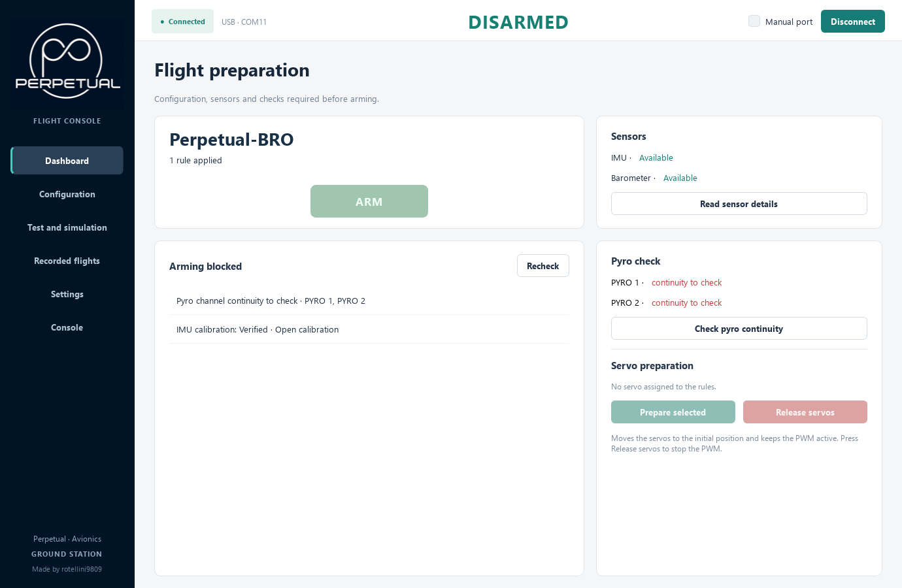

1. **Sensors**: IMU and barometer must be *Available*. **Read sensor details** opens live plots,
   useful to check that the board responds when you move it:

   

     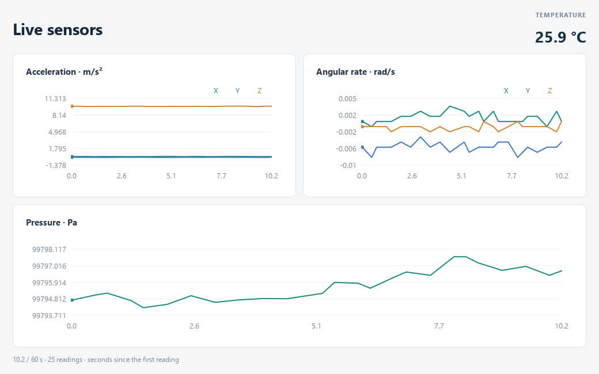
   

2. **Pyro check**: with the igniters connected, press **Check pyro continuity**. Each pyro channel
   used by your rules must report continuity. The result stays on screen for 10 minutes and is
   cleared when the board returns to disarmed, so check again after a flight or a cancelled arm.
   While armed the card shows *verified by the board at arming*: the board measures continuity
   itself when it accepts the arm and again before flight, whatever the card shows.
3. **Servo preparation**: tick the servos used by your rules and press **Prepare selected**. They
   move to their initial position and hold it. **Release servos** lets them go again.
4. **Preflight checks**: lists what still blocks arming, and the board decides this list. Fix each
   item, then press **Recheck**. When the list is empty, **ARM** turns solid green.
5. **Hold ARM for 1.5 seconds** (mouse, or Space / Enter). Releasing early cancels. The board first
   measures the gyroscope at rest, so **keep the rocket still**; then it waits on the pad, armed.

To disarm, hold **DISARM** for 1.5 seconds in the same way.

The board's RGB LED shows the flight phase, so you can check it without the app:

| LED | Phase |
|---|---|
| Blue | Disarmed |
| Pulsing blue | Measuring the gyroscope after ARM: keep still |
| Amber | PAD, armed and waiting for launch |
| Red | BOOST |
| Magenta | COAST |
| Cyan | DESCENT |
| Green | LANDED |
| Slow rainbow | Power saving |

### Step 8 — After the flight

1. Connect to the board (USB, or Bluetooth if you can't reach the board yet).
2. **Recorded flights → Read flights from board**, select the flight, **Download selected**.
3. Look at the plots and the Flight data table, as in [step 6](#step-6--check-the-result).
4. Keep the CSV and JSON files: they are the complete record of the flight. **Open local CSV**
   opens them again later, even without the board.

Flights stay on the board until the memory is formatted or a newer flight needs their space: the
board keeps up to 32 flights and overwrites the oldest first. Download a flight soon after it
flies.

## Other tools

**Console.** Send any firmware command (`status`, `config show`, `help`…) and read the raw reply.
The app's own requests appear here too, which helps when something does not behave as expected.

  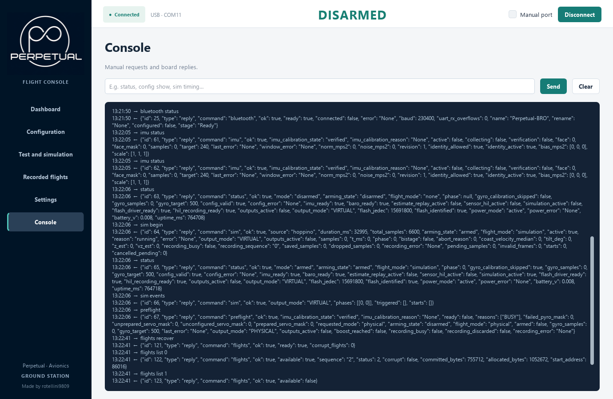

**Language.** **Settings → Language** switches between English and Italian; the app restarts to
apply it. Error messages always stay in English.

**Factory reset and Format memory**, at the bottom of **Settings**:

| Action | Deletes | Keeps |
|---|---|---|
| **Factory reset** | Rules, servo positions and orientation | Recorded flights |
| **Format memory** | All recorded flights | Configuration |

Download any flight you want to keep **before** formatting.

## Good to know

- **Nothing is saved automatically.** Rules are saved by **Apply**, settings by their **Save**
  buttons. If you close the app with an unapplied draft, it asks for confirmation.
- **Recording time.** Each flight records about **16 minutes** from launch at full rate. A longer
  flight still runs its phases and rules to the end, but the data after those 16 minutes is not
  saved. A flight that long uses the whole memory and overwrites all older flights.
- **Power saving.** After five minutes without activity the board puts its sensors and memory to
  sleep, even while connected; the Dashboard shows **POWER SAVE ACTIVE**. Any operation wakes it up.
- **One controller at a time.** If the board is connected over USB and Bluetooth at the same time,
  only the link that started an operation can control it until the operation ends.
- **Several boards.** If more than one board is found, the app asks which one to use.

## Troubleshooting

| Problem | What to do |
|---|---|
| The app doesn't find the board | Check the USB cable and close the PlatformIO Serial Monitor or any other program using the port, then press **Connect**. Over Bluetooth, make sure the board is paired in Windows |
| ARM stays faded | Read the **Preflight checks** list on the Dashboard, fix each item and press **Recheck** |
| "Pyro channel continuity to check" | Connect the igniters to the channels used by your rules and press **Check pyro continuity** |
| A servo shows "To configure" | Set its positions in **Configuration → Channels** ([step 4](#step-4--set-the-servo-positions)) |
| The IMU calibration asks for verification | Run **Verify calibration** ([step 2](#step-2--calibrate-the-imu)) |
| Start simulation is disabled | The reason is shown below the buttons: usually an unapplied draft, or no valid configuration on the board |
| Bluetooth drops after renaming | Expected: the module restarts and the app reconnects by itself |
| A capture keeps restarting during calibration | Put the board on a stable surface and don't touch it until the bar fills |
