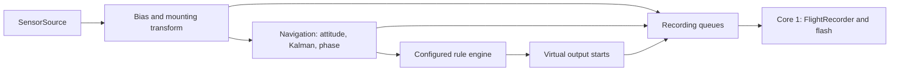

# Application architecture

`src/main.cpp` wires the application. `include/` mirrors the component directories. The current
MAIN boots disarmed. Simulation/HIL use the shared arming controller and runtime; production
physical flight and opt-in physical simulation share `OutputExecutor`. Normal flight always
selects real outputs; simulation defaults to virtual. Real sensor faults still block live arming.

| Directory | Responsibility |
|---|---|
| `hardware/` | Board drivers, sensor acquisition, clock-driven status LED and peripheral power state |
| `flight/` | Shared arming controller, RAM calibration, sensor runtime and exclusive run/plan ownership |
| `navigation/` | Attitude, vertical Kalman, phase detector, common preprocessing/pipeline |
| `configuration/` | Plan/validator, rule engine, applied/draft settings service and edit commands |
| `storage/` | SPI flash adapter/profiler, settings, directory, record stores and queued writer |
| `simulation/` | HIL input adapter, embedded Hoppino source/reporting and estimate replay |
| `communication/` | Per-connection framing/retry/reply buffers, bounded JSON and shared command router |
| `diagnostics/` | Manual test entry points selected by build flag |
| `include/shared/` | Flight phases, timestamped estimates and timing values |
| `test/host`, `test/integration`, `test/fixtures` | Ten C++ area suites, four Python groups and shared PC-only fixtures; one stdin command device for real client integration |
| `tools/replay/` | Independent PC references, USB runners and downloader |
| `tools/device_client.py` | Shared PC protocol, serial ownership, request FIFO/idle heartbeat and CLI monitor |
| `perpetual_app/` | Qt views, app state/operation controller, pure local configuration model and portable Windows build |

## Processing path

Sources supply measurements, not estimates, phases or actuator decisions. `SensorPipeline`
freezes one source, convention, calibration and launch reference for the run. A mid-run
convention change stops processing. No simulation branches belong in the Kalman filter or flight
detector. Raw `SensorAxes` input subtracts accelerometer and gyro biases in sensor coordinates,
then applies a proper rotation selected by the signed noseward sensor axis (default +X).
`LoggedCalibratedBody` bypasses both operations for data already processed that way.
See [navigation](NAVIGATION.md) for units/freshness.

`HilSensorSource` is a one-frame mailbox: unread data cannot be overwritten.
`HilSession::sample()` supplies acquisition IDs for synchronous samples; `process()` accepts
full typed `Reading` metadata. `flight::FlightRuntime::poll()` reads the selected source and
owns timestamp validation, preprocessing/navigation, rules, optional recording and timing.
`HilSession` only fills the mailbox and calls the shared `ArmingController`, as does
`SimulationSession` with its `SimulatedSensorSource` (flash-resident Hoppino BODY readings at
their original timestamps, nominal 200 Hz; finite pressure rows are fresh as in sensor HIL).
The controller owns FlightRuntime. Simulation mode begins immediately without real sensor checks
or gyro calibration. Physical mode checks readiness, reserves the configuration during its
nonblocking RAM calibration, rechecks readiness, then starts the same runtime. See
[navigation](NAVIGATION.md#calibration-and-mounting) for collection policy. Temperature is logged
without affecting navigation. `OutputExecutor` is an optional runtime dependency: virtual runs
never touch it; physical simulation shares the same rule starts and independently timed outputs.
`BoardOutputs` adapts GPIO/PWM, leaving pulse timing in the host-testable executor. Physical start
records use command/pulse-high timestamps; recording headers retain the selected output mode.

`HardwareSensorSource` uses real `Sensors` via the small `SensorDevice` boundary. Only fresh
IMU pairs emit flight frames; barometer acquisition identities/times advance independently.
Missing IMU data never becomes synthetic acceleration/gyro. MAIN currently polls this source
for idle diagnostics only, including barometer-only operation, and pauses those reads during
HIL/simulation and uses it during real arming/flight. Acquisition times are polling timestamps, not
hardware interrupt edges; actual cadence and overruns still need board verification.

## Shared arming lifecycle

`ArmingController` has Disarmed, Arming, Armed and Closing states. Simulation goes directly from
Disarmed to Armed after common configuration/optional recording checks. Physical mode requires
IMU/barometer initialization, initialized recording storage, continuity on configured pyros,
prepared configured servos and output availability. `PhysicalChecks` supplies real sensor readiness;
`OutputExecutor` supplies the same continuity/preparation checks used in simulation.
`servo arm [channel]` commands Initial and holds PWM. Normal flight adopts that preparation without
detach/reposition, whereas physical simulation prepares automatically. Preparation survives a failed
arm or disconnect, but Disarm releases it and relevant configuration changes invalidate it.
Virtual runs reject held physical preparation rather than carrying active PWM into a virtual run.

While collecting physical calibration, the configuration reservation blocks edits, competing
runs and bulk storage operations. Calibration frames are neither navigated nor recorded. The
reservation is transferred to RunController without yielding on core 0. Source `start()` resets
the acquisition epoch after recording preparation so calibration time is excluded from flight
time; stop clears RAM calibration and cancels future starts. Closing remains visible until the
queued recording worker acknowledges finalization. Owner disconnect leaves autonomous simulation
and physical arming/flight running, but stops its injected HIL/estimate replay.

Ordinary `disarm` is accepted during arming and at PAD/LANDED, and rejected during the airborne
phases. `sim stop` immediately shuts down selected physical/virtual outputs; `hil stop` remains a virtual
development cancellation path. After LANDED, physical runs close future starts at the 15-second
window, finish active bounded pyro pulses, then release PWM and request asynchronous log close.
Servo holding does not extend that wait. Explicit stop/disarm shuts outputs down immediately.
Recording is prepared after gyro collection and before adopting outputs; failure never reaches
Armed and preserves pre-existing preparation. Flash failures use existing recovery diagnostics;
a separate provisional allocation format remains future work. Orderly physical-mode closure
now discards a log that never reached BOOST; simulation/HIL retain diagnostic PAD logs. The
shared runtime tracks launch independently of sample persistence, and the worker commits the
discard before releasing storage. PC tests exercise sensor-axis acquisition, gyro collection,
physical output commands, recorded start times and asynchronous close through fake GPIO/sensors.
Electrical/mechanical qualification still requires repaired hardware.

## Service ownership

`ConfigurationService` owns applied/draft settings and validation/save/readback;
`ConfigurationCommands` only parses and renders edits. The pure model and `RecoveryRuleEngine`
have no hardware/USB/storage dependencies. Rules belong to configuration and consume navigation
snapshots; deployment names do not become phases.

`flight::RunController` owns one copied plan/engine, increasing time/sequence checks, event progress, a
monotonic run identity, the development post-landing cutoff and cancellation. An obsolete
runtime cannot stop/process a replacement run. USB sensor HIL and autonomous simulation use
separate runtime instances sharing this exclusive run owner. Generated height only determines
pressure; navigation and flight phases are always computed by the common runtime. Hardware
sources use the same runtime API, verified on PC with a fake acquisition device.

`CommandRouter` dispatches configuration, replay, HIL, simulation and flights as sibling
handlers, plus arming/preflight. It permits settings inspection but rejects mutations/competing
runs while arming, running or the recording worker still owns flash. `CommandSession` binds
each endpoint to USB or Bluetooth. The connection owning a draft/run controls mutations; the
other can inspect it. Only owner disconnect discards the draft or ends host-fed runs.
Autonomous simulation and physical arming/flight keep running and permit a new owner.

## Core and flash ownership

Core 0 performs sensor processing, rules, USB/Bluetooth and RAM queue submission. It prepares recording
storage synchronously while idle, then publishes exclusive ownership to core 1. `QueuedRecorder`
wraps the synchronous `FlightRecorder` behind `RecordingSink`; producer-facing headers expose
shared values without pulling in concrete stores. Fixed queues hold 64 samples and eight
independent starts. The worker uses a separate 8 KiB stack and sleeps on events when idle.

Close/abort requests return immediately. Core 1 retains flash ownership until its release
acknowledgment, including during final drain or an in-progress operation. Only afterward may
core 0 inspect native buffers, change persistent settings, download or recover. Live status uses
producer-owned snapshots/atomic counters.
See [storage](STORAGE.md) for the detailed handoff/failure contract.

`FlashLoggerAdapter` connects the physical driver to `FlashDevice`; MAIN adds
`ProfiledFlashDevice` for RAM timing/failure snapshots. Settings and recording share this single
owner. `BinaryEncoding` centralizes little-endian/CRC operations; `VerifiedPage` centralizes
page program/readback without retries or allocation. `CommandProtocol` supplies bounded
tokens/numbers/JSON; `CommandService` owns framing and request-ID deduplication, independent
of the command handlers. `CommandEndpoint` owns each pending response; `Jdy34Link` owns the
portable nonblocking AT startup and connection-notification filter. MAIN supplies hardware
UART1/USB IO and PWRC control; Bluetooth does not need a second core.

MAIN polls due autonomous sensor work before either endpoint, even disconnected. Both endpoints
get a bounded turn every loop, with no USB polling throttle. Scheduling is cooperative,
not a hardware-timer deadline guarantee. Idle preparation, configuration writes and bulk scans
may still block core 0. `PowerManager` enters peripheral sleep only after the router confirms
idle state, no pending reply and no recent bulk-read activity. Core 1 remains in its existing
idle wait. `BoardPower` releases outputs and suspends sensor/flash drivers; wake
reinitializes those drivers without restoring preparation. USB/Bluetooth and the status LED
continue on core 0. Five minutes without operational commands or active work triggers sleep,
even with clients connected; passive status/heartbeat traffic does not reset the clock.
Operational requests wake peripherals before normal dispatch, without replaying a failed request.
Wake initialization remains synchronous while idle; MCU deep sleep is not implemented.
See [commands](USB.md#power-saving).
