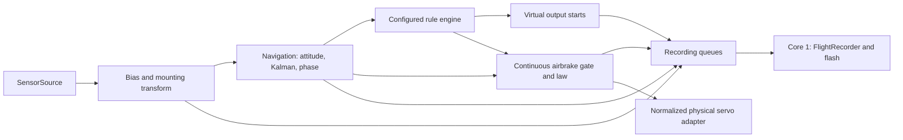

# Application architecture

`src/main.cpp` wires the application. `include/` mirrors the component directories. The current
MAIN boots disarmed. Simulation/HIL use the shared arming controller and runtime; production
physical flight and opt-in physical simulation share `OutputExecutor`. Normal flight always
selects real outputs; simulation defaults to virtual. Real sensor faults still block live arming.

| Directory | Responsibility |
|---|---|
| `hardware/` | Board drivers, sensor acquisition, clock-driven status LED and peripheral power state |
| `flight/` | Shared arming controller, RAM calibration, sensor runtime and exclusive run/plan ownership |
| `control/` | [Airbrake law contract, continuous gate and normalized servo commands](AIRBRAKES.md) |
| `navigation/` | Attitude, vertical Kalman, phase detector, common preprocessing/pipeline |
| `configuration/` | Plan/validator, rule engine, applied/draft settings service and edit commands |
| `storage/` | SPI flash adapter/profiler, settings, directory, record stores and queued writer |
| `simulation/` | HIL input adapter, embedded Hoppino source/reporting and estimate replay |
| `communication/` | Per-connection framing/retry/reply buffers, bounded JSON and shared command router |
| `diagnostics/` | Manual test entry points selected by build flag |
| `include/shared/` | Flight phases, timestamped estimates and timing values |
| `test/host`, `test/integration`, `test/fixtures` | C++ area suites, Python integration suites and shared PC-only fixtures; one stdin command device for real client integration |
| `tools/replay/` | Independent PC references, USB runners and downloader |
| `tools/device_client.py` | Shared PC protocol, serial ownership, request FIFO/idle heartbeat and CLI monitor |
| `perpetual_app/` | Qt views, app state/operation controller, pure local configuration model and portable Windows build |

## Processing path

Sources supply measurements, not estimates, phases or actuator decisions. `SensorPipeline`
freezes one source, convention, calibration and launch reference for the run. A mid-run
convention change stops processing. No simulation branches belong in the Kalman filter or flight
detector. Raw `SensorAxes` input subtracts accelerometer and gyro biases in sensor coordinates,
then applies the explicitly saved signed noseward sensor-axis rotation.
`LoggedCalibratedBody` bypasses both operations for data already processed that way.
See [navigation](NAVIGATION.md) for units/freshness.

`HilSensorSource` is a one-frame mailbox: unread data cannot be overwritten.
`HilSession::sample()` supplies acquisition IDs for synchronous samples; `process()` accepts
full typed `Reading` metadata. `flight::FlightRuntime::poll()` reads the selected source and
owns timestamp validation, preprocessing/navigation, rules, optional recording and timing.
`HilSession` only fills the mailbox and calls the shared `ArmingController`, as does
`SimulationSession` with its `SimulatedSensorSource` (flash-resident Hoppino BODY readings at
their original timestamps, nominal 200 Hz; finite pressure rows are fresh as in sensor HIL).
The controller owns FlightRuntime. Simulation mode begins immediately without real sensor checks
or gyro calibration. Physical mode checks readiness, reserves the configuration during its
nonblocking RAM calibration, rechecks readiness, then starts the same runtime. See
[navigation](NAVIGATION.md#calibration-and-mounting) for collection policy. Temperature is logged
without affecting navigation. `OutputExecutor` is an optional runtime dependency: virtual
evaluation never submits physical starts, though virtual simulation startup releases held PWM.
Physical simulation shares the same rule starts and independently timed outputs.
`BoardOutputs` adapts GPIO/PWM, leaving pulse timing in the host-testable executor. Physical start
records use command/pulse-high timestamps; recording headers retain the selected output mode.

`HardwareSensorSource` uses real `Sensors` via the small `SensorDevice` boundary. Only fresh
IMU pairs emit flight frames; barometer acquisition identities/times advance independently.
Missing IMU data never becomes synthetic acceleration/gyro. MAIN currently polls this source
for idle diagnostics only, including barometer-only operation, and pauses those reads during
HIL/simulation and uses it during real arming/flight. Acquisition times are polling timestamps, not
hardware interrupt edges; actual cadence and overruns still need board verification.

## Shared arming lifecycle

`ArmingController` owns the operational lifecycle and coordinates calibration, readiness,
exclusive runtime ownership and asynchronous close. Its actual transition functions, the
normal flight detector and implemented bistage/ABORT behavior have one reference:
[state machines](state_macines.md).

For physical arming, see [readiness and commands](USB.md#arming-and-readiness);
for calibration and mounting, see [navigation](NAVIGATION.md#calibration-and-mounting).
Physical flight and opt-in physical simulation share `OutputExecutor`; virtual simulation
releases held servo preparation before starting. A prepared servo alone remains DISARMED.
The physical adapter and shared collector are host-tested with fake GPIO/sensors; repaired-IMU
acquisition and electrical/mechanical output behavior still require bench qualification.

## Service ownership

`ConfigurationService` owns applied/draft settings and validation/save/readback;
`ConfigurationCommands` only parses and renders edits. The pure model and `RecoveryRuleEngine`
have no hardware/USB/storage dependencies. Rules belong to configuration and consume navigation
snapshots; deployment names do not become phases.

`flight::RunController` owns one copied plan/engine, increasing time/sequence checks, event progress, a
monotonic run identity, the development post-landing cutoff and cancellation. An obsolete
runtime cannot stop/process a replacement run. USB sensor HIL and autonomous simulation use
separate runtime instances sharing this exclusive run owner. Source readings supply measured
or replayed sensor values; navigation and phases are computed by the common runtime. Hardware
sources use the same runtime API, verified on PC with a fake acquisition device.

`CommandRouter` dispatches configuration, replay, HIL, simulation and flights as sibling
handlers, plus arming/preflight. It permits settings inspection but rejects mutations/competing
runs while arming, running or the recording worker still owns flash. `CommandSession` binds
each endpoint to USB or Bluetooth. The connection owning a draft/run controls mutations; the
other can inspect it. Only owner disconnect discards the draft or ends host-fed runs.
Autonomous simulation and physical arming/flight keep running and permit a new owner.

## Core and flash ownership

Core 0 performs sensor processing, rules, USB/Bluetooth and RAM queue submission. Physical arming publishes
asynchronous preparation to core 1 and remains `preparing` until acknowledgment; only then
can it enter `armed`. HIL/simulation retain the synchronous preparation entry. `QueuedRecorder`
wraps the synchronous `FlightRecorder` behind `RecordingSink`; producer-facing headers expose
shared values without pulling in concrete stores. Fixed queues hold 64 samples and eight
independent starts. The worker uses a separate 8 KiB stack and sleeps on events when idle.

Close/abort requests return immediately. Core 1 retains flash ownership until its release
acknowledgment, including during final drain or an in-progress operation. Only afterward may
core 0 inspect native buffers, change persistent settings, download or recover. Live status uses
producer-owned snapshots/atomic counters.
See [storage](STORAGE.md) for the detailed handoff/failure contract.

`FlashLoggerAdapter` connects the physical driver to `FlashDevice`; MAIN adds
`ProfiledFlashDevice` for RAM timing/failure snapshots. Settings and recording share this single
owner. `BinaryEncoding` centralizes little-endian/CRC operations; `VerifiedPage` centralizes
page program/readback without retries or allocation. `CommandProtocol` supplies bounded
tokens/numbers/JSON; `CommandService` owns framing and request-ID deduplication, independent
of the command handlers. `CommandEndpoint` owns each pending response; `Jdy34Link` owns the
portable nonblocking AT startup and connection-notification filter. MAIN supplies hardware
UART1/USB IO and PWRC control; Bluetooth does not need a second core.

MAIN polls due autonomous sensor work before either endpoint, even disconnected. Both endpoints
get a bounded turn every loop, with no USB polling throttle. Scheduling is cooperative,
not a hardware-timer deadline guarantee. Idle preparation, configuration writes and bulk scans
may still block core 0. `PowerManager` enters peripheral sleep only after the router confirms
idle state, no pending reply and no recent bulk-read activity. Core 1 remains in its existing
idle wait. `BoardPower` releases outputs and suspends sensor/flash drivers; wake
reinitializes those drivers without restoring preparation. USB/Bluetooth and the status LED
continue on core 0. Five minutes without operational commands or active work triggers sleep,
even with clients connected; passive status/heartbeat traffic does not reset the clock.
Operational requests wake peripherals before normal dispatch, without replaying a failed request.
Wake initialization remains synchronous while idle; MCU deep sleep is not implemented.
See [commands](USB.md#power-saving).

## Firmware maintainability and duplication audit - 2026-10-27

### Scope and baseline

Reviewed application-owned src/include C++ for responsibility boundaries,
boilerplate, exact repeated blocks, unused API candidates and embedded constraints.
Generated Hoppino samples and third-party drivers were excluded from duplication
counts. This began as a source audit with recommendations, not a guarantee that every
unused symbol has been identified by whole-program analysis. Completed follow-ups
are listed below.
The audit itself changed no C++ behavior, board settings or firmware upload.

The code is already divided into useful components. The largest implementation is
Sensors.cpp (371 lines); FlightRecorder.cpp is 280, main.cpp 278, FlightHeaderStore.cpp
248, ConfigurationCommands.cpp 237, ArmingController.cpp 227 and FlightRuntime.cpp
214 at this snapshot. File size alone does not justify further fragmentation.
An exact six-line-block scan mostly found diagnostic initialization copies; the
more valuable production duplication is semantic and requires manual review.

Baseline verification: `python tools/run_tests.py --full` passed 14 suites;
PlatformIO MAIN build passed. Linker reports 63092 bytes static RAM and 438496 bytes
program flash. These are not measurements of worst-case stack or runtime timing.
No byte, speed or memory savings are claimed for unimplemented recommendations.

### Completed follow-ups

The selected four refactors are implemented without changing the flight algorithm,
storage format, JSON response fields/order or command guard precedence:

| Responsibility | Owner |
|---|---|
| Finite/range validation of device and recorded bistage settings | configuration/StateMachineValidation.h, called independently by service and stores |
| One classification for ownership, busy, maintenance and power policy | communication/CommandPolicy.h; CommandRouter computes and reuses the result |
| Shared recording busy/count/error/pending JSON fragments | communication/RecordingReply.h; each handler keeps its own fields and one runtime snapshot |
| Bounded XOR/CRC/Base64 download encoding | communication/PackedFlightCodec.h; FlightCommands retains guards, selection and transfer lease |

Regression checks include a command-policy case matrix (including malformed input),
validator boundaries/non-finite values, exact reply fragments, codec golden bytes,
invalid offsets, bounded maximum replies and the production Python downloader.
All 15 suites (`--full --desktop`) and the RP2350 MAIN build passed after the change.
Golden storage-format checks remain unchanged. No format or hardware upload is
required merely to review this refactor; the board needs the new firmware to run it.
Other deletion/helper candidates from the audit were not included in this change.

### Recommended changes, in priority order

1. **Implemented: one command classification in CommandRouter.**
   [CommandRouter.cpp](../../src/communication/CommandRouter.cpp) previously classified config
   groups and read-only operations in both dispatchFrom and dispatchCommand;
   mutation, operational/wake, maintenance and begin-run policy is spread over
   adjacent boolean expressions. Orientation and machine query exceptions appear
   in both locations. A new command previously required coordinated edits.
   The router now computes a small, explicit classification result from command
   and tokens and passes the result into dispatchCommand. Handler validation stays independent;
   preserve error precedence, transport ownership and wake behavior. Do not build
   a dynamic command registry or add allocation/virtual dispatch for this.
   Acceptance: table-driven policy tests for read/write variants, malformed input,
   unknown commands, draft/run/storage busy, USB/Bluetooth ownership, sleep/wake,
   simulation/HIL/physical sessions; unchanged wire replies and retry semantics.

2. **Implemented: one validator for state-machine settings.**
   The finite/nonnegative/maximum-100000 velocity rule was repeated in
   ConfigurationService::setStateMachine, ConfigurationStore load/save and
   FlightHeaderStore::validCalibration. StateMachineValidation now owns the pure validity predicate and named bound;
   each layer retains its validation call, error mapping and readiness handling. A missing/erased device record intentionally defaults to normal mode,
   while an unavailable flight calibration snapshot has a different contract.
   Those cases must not be flattened into one generic settings loader.
   Acceptance: normal/bistage, exact bounds, negative/NaN/infinity/too-large values,
   erased vs corrupt settings and factory reset; identical persisted bytes.

3. **Small binary primitives instead of repeated storage loops (medium value,
   low risk when narrowly scoped).**
   [BinaryEncoding.h](../../include/storage/BinaryEncoding.h) already owns integer
   encoding and CRC. Add a bounded erased-byte predicate to replace three local
   erased() functions in FlightHeaderStore, FlightSampleStore and FlightSummaryStore,
   the directory's allFF wrapper and equivalent blank-page loops. Consider raw
   IEEE-754 word load/store helpers for the repeated memcpy/integer conversions.
   Retain canonical-NaN handling in sample encoding and finite-value validation
   at each format boundary. Do not reinterpret_cast native structs onto storage.
   Preserve magic/version fields, reserved bytes, CRC coverage, commit order,
   error types and failure IO policy. Golden-format and fault-injection tests
   must remain identical; this should not require formatting flight memory.

4. **Implemented: shared recording-status reply fragments.**
   SensorHilCommands, SimulationCommands and ArmingCommands serialize overlapping
   recording_busy/error and, where applicable, sequence/saved/dropped/pending
   fields. RecordingReply now supplies small common fragments using one RuntimeStatus
   snapshot per reply. Keep source-specific
   fields and the existing JSON shape outside the helpers; a universal full-status
   serializer would add fields or fill the bounded JSON buffer unnecessarily.
   RecordingReply, TimingReply, RunReply and ArmingReply are existing patterns to
   follow, not abstractions to replace. Verify maximum replies, missing values,
   completed/faulted asynchronous recording and actual physical/virtual modes.

5. **Remove unused servo-driver API/state after build-mode verification
   (concrete deletion candidate).**
   [ServoController.cpp](../../src/hardware/ServoController.cpp) has no callers of
   setAngle() or center() in the scanned src/include/test C++ sources. The private
   active[4] array is only assigned by setPulse/stop and never read. Candidates
   are those methods, their private angle-clamping helper, angle/center-only config
   fields/defaults and the write-only array. The used path is begin/setPulse/stop
   through BoardOutputs; pulse bounds, initial pulse on attachment, detach behavior
   and channel validation remain necessary. Check all diagnostic entry points and
   intended external consumers before deletion. Linker garbage collection may
   already remove unused functions; fewer source lines do not imply flash savings.

6. **Implemented: packed transfer codec isolated from the flights command handler.**
   FlightCommands::dispatch previously contained XOR packing, payload budgeting,
   CRC and Base64 alongside command dispatch. PackedFlightCodec now owns this
   pure bounded codec, keeping the 448-byte budget, reset-per-reply XOR state and
   existing sample-v2 encoder.
   FlightCommands retains selection, session/arming guards and transfer lease.
   Use bit-exact boundary/NaN/CRC tests and the real Python downloader integration.
   The diagnostic text read command is still exercised by tests; do not label it
   dead code merely because the app uses packed transfer.

7. **Local shared helpers for diagnostics/SPI only where behavior is identical
   (lower priority).**
   ConfigurationStoreDeviceTest, FlashDeviceTest and FlightDirectoryDeviceTest
   contain identical output-initialization blocks. Other diagnostics use different
   low-level initialization orders. A diagnostics-only inactive-output helper is
   reasonable after reconciling GPIO latch/direction and chip-select semantics;
   it must not run a servo-centering or firing path.
   Sensors.cpp repeats SPI begin/select/transfer/deselect/end in Bosch/ST callbacks.
   Small transaction/read/write helpers may reduce boilerplate, with sensor-specific
   register flags and return conventions left in their wrappers. Do not merge
   acquisition cadence, status-register rules, bus speeds or device reset sequences.
   GPIO and sensor callback changes need target/bench checks, not just host tests.

### Similar code that should remain independently enforced

- Run/arming/draft checks at router, service and runtime boundaries defend different
  entry points and preserve distinct errors. Share policy predicates selectively;
  do not remove checks merely because a higher layer also validates a request.
- SimulationSession and HilSession already reuse ArmingController/FlightRuntime.
  They differ in source scheduling, EOF, mailbox ownership and stop/disconnect
  semantics. They are not duplicate flight engines to merge into a new hierarchy.
- RecordingSink, FlightRecorder and QueuedRecorder separate producer acceptance,
  durable writes and core-1 acknowledgment. Similar accessors/guards are not a
  reason to collapse the worker boundary or read counters before acknowledgment.
- Directory/header/sample/summary commits and readbacks have format-specific
  semantics. BinaryEncoding and VerifiedPage are the shared primitives; avoid a
  universal storage-record superclass or automatic retry behavior.
- BOOST 1/2 share criteria, but COAST 1 adds a finite velocity window and continuous
  tilt gate. A repeated predicate can be named; transition ordering and ABORT's
  completion of already-started outputs must remain unchanged.
- main.cpp is the composition root plus bounded board polling. Extract a board
  status/transport adapter only if that responsibility grows; relocating 278 lines
  into another file without a clearer owner is not a maintainability improvement.
- Enum-to-name switches, short forwarding methods and explicit bounded casts are
  generally cheap and readable. Avoid reflection/X-macro frameworks or blanket
  wrappers simply to shorten them. Physical units/constants may intentionally use
  different inherited values; changing numerical policy is not deduplication.

### Suggested sequence and validation

The validator, router classification, reply fragments and packed codec are complete.
Remaining candidates are the pure storage predicates and unused servo API/state.
Leave GPIO/SPI helper changes for a dedicated hardware-qualified step.
Do not combine all of these with a storage-format revision or flight-algorithm edit.

Run affected host suites after each change, then `python tools/run_tests.py --full`
and a MAIN target build. Storage helpers require the storage golden/corruption/
recovery suites; router/reply/codec work requires commands, clients, recording and
simulation; lifecycle changes also require flight/navigation. Changes to wire
responses require the desktop suite. Compile relevant diagnostic build modes when
removing driver API or changing boot helpers, and restore MAIN configuration.
No hardware upload or output activation is necessary for this source-audit step.
