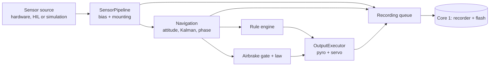

# Firmware architecture

`src/main.cpp` wires the application together. Every component has its implementation in
`src/<area>/` and its public header in `include/<area>/`.

## Source map

| Directory | Responsibility |
|---|---|
| `hardware/` | Board drivers: sensors (`Sensors`, `HardwareSensorSource`), pyro and servo outputs, JDY-34 link and Bluetooth name, status LED, peripheral power |
| `navigation/` | Sensor preprocessing (`SensorPipeline`), attitude, vertical Kalman filter and flight phase detection |
| `flight/` | Arming lifecycle (`ArmingController`), run ownership (`RunController`), the shared runtime (`FlightRuntime`), output timing (`OutputExecutor`), gyro collection at arming and IMU calibration |
| `configuration/` | Rule model and validator, rule engine, applied/draft settings (`ConfigurationService`) and their commands |
| `control/` | [Airbrake](AIRBRAKES.md) gate, control law contract and servo commands |
| `storage/` | Flash driver adapter, settings stores, flight directory, recorder and its core-1 worker |
| `simulation/` | Sensor HIL, embedded Hoppino and bistage simulation sources, estimate replay |
| `communication/` | Framing, request IDs and replies per connection (`CommandService`), command routing and arming commands |
| `diagnostics/` | Standalone test firmwares selected by build flag |
| `include/shared/` | Flight phases, timestamped estimates and timing types shared by all areas |

On the PC side, [`tools/device_client.py`](../../tools/device_client.py) implements the protocol
used by the [desktop app](DESKTOP.md) and the command-line tools.

## Processing path

A **sensor source** supplies measurements only, never estimates, phases or output decisions.
There are three:

- `HardwareSensorSource`: the real IMU and barometer (see [Hardware](../HARDWARE.md#sensors)).
- `HilSensorSource`: frames sent by the PC over USB, one frame at a time.
- `SimulatedSensorSource`: the embedded Hoppino flight (200 Hz) or a synthetic two-stage profile.

`FlightRuntime::poll()` reads the selected source and does everything else the same way for all
three: timestamp checks, preprocessing, navigation, rules, airbrakes, outputs and optional
recording. Simulation therefore exercises the flight code itself; there are no simulation branches
in the filter or the detector.

`SensorPipeline` freezes the source, the calibration and the launch reference for the whole run.
It subtracts the accelerometer and gyro biases in sensor axes, then rotates into the body frame
with the saved mounting. See [Navigation](NAVIGATION.md) for frames, units and freshness rules.

## Runs and arming

`ArmingController` owns the lifecycle of every run: physical flight, physical or virtual
simulation, and sensor HIL. The transitions are in [State machines](STATE_MACHINES.md).

- **Physical flight** checks readiness (`preflight`), reserves the configuration, collects the
  gyroscope bias and gravity reference at rest, checks readiness again, then starts the runtime
  with real outputs.
- **Simulation and HIL** start immediately, without sensor checks or gyro collection. Outputs
  are virtual unless a physical simulation is requested.

`RunController` owns the single active run: a copy of the plan and rule engine, time and
sequence checks, event progress and cancellation. A stale runtime can never act on a newer run.

`OutputExecutor` is the only owner of the pyro and servo outputs. It times each output
independently and drives the hardware through `BoardOutputs`, a thin GPIO/PWM adapter, so all
timing is testable on the PC. Physical flight and physical simulation use it; virtual runs record
the same output starts without driving anything.

## Configuration and commands

`ConfigurationService` owns the applied settings and the per-connection draft, with validation,
save and read-back; `ConfigurationCommands` only parses and prints. The rule model and
`RecoveryRuleEngine` have no hardware, transport or storage dependencies. See
[Configuration](CONFIGURATION.md).

`CommandService` runs once per connection (USB and Bluetooth), each with its own framing, retry
cache and pending reply. `CommandRouter` dispatches to the configuration, arming, simulation, HIL,
replay and flight handlers. The connection that owns a draft or a run controls it; the other can
inspect. See [USB/Bluetooth](USB.md).

## Cores and flash

Core 0 runs sensors, navigation, rules, outputs and both connections. Core 1 runs only the
recorder: core 0 pushes samples and output starts into fixed RAM queues, and core 1 writes them to
flash, so flash timing never blocks the flight loop. While core 1 owns the flash, core 0 does not
touch it; settings changes, downloads and recovery wait until it is released. Settings and flight
storage share the one flash device. See [Storage](STORAGE.md).

## Main loop and power

The main loop is cooperative: each pass services due sensor work first, then gives each
connection a bounded turn. There are no hardware-timer deadline guarantees, and idle operations
such as configuration writes can still block core 0 briefly.

`PowerManager` puts the peripherals to sleep after five minutes without operational commands or
active work, even with clients connected; passive status traffic does not reset the timer. Any
operational command wakes the board first. USB, Bluetooth and the LED keep running; the MCU itself
does not deep-sleep. See [Hardware](../HARDWARE.md#status-led-and-power-saving).
