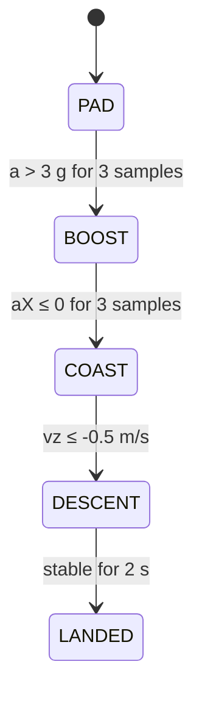
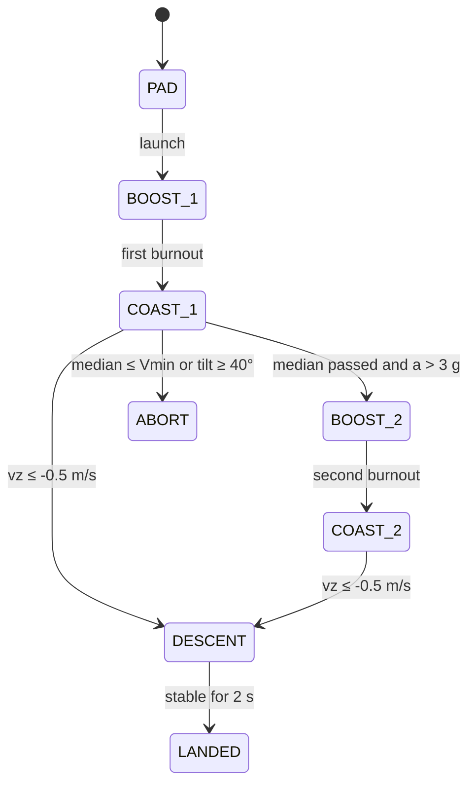
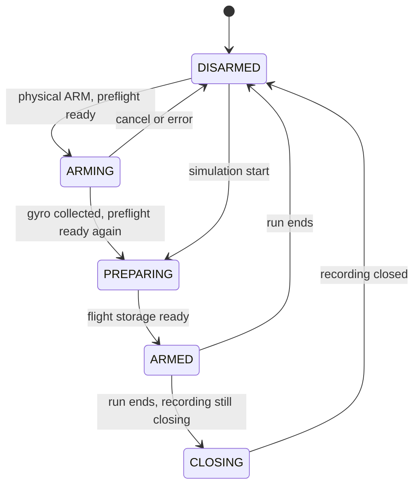

# State machines

The firmware has two independent machines:

- the **flight machine** in `navigation::FlightDetector`, which turns sensor data into flight
  phases, in a normal and a bistage (two-stage) variant;
- the **arming machine** in `flight::ArmingController`, which governs runs: arming, recording and
  closing.

Both are identical in real flight and in simulation. Qualification limits on real hardware are
tracked in [Validation](../testing/VALIDATION.md#remaining-work-and-limits).

## Conventions

- `a`: magnitude of the specific acceleration measured by the accelerometer, m/s².
- `aX`: specific acceleration along BODY X, which points to the rocket nose after the mounting
  rotation. It is not gravity-compensated vertical acceleration.
- `vz`: estimated vertical velocity, positive up, m/s. The detector uses the value from the
  previous cycle, before the current Kalman prediction and correction.
- `θ` (tilt): angle between the rocket's longitudinal axis and the upward vertical.
- A **valid sample** is fresh, distinct from the previous one and finite. Reading the same sample
  twice never counts twice.
- **Consecutive confirmation**: some transitions need three consecutive valid IMU samples. The
  count restarts when the condition fails, a frame is invalid or duplicated, the IMU sequence
  is interrupted, or the interval exceeds twice the nominal period.

A frame with non-finite inputs or `dt` outside `(0, 0.1 s]` never changes the phase.

## Normal flight machine

| From | Condition | To |
|---|---|---|
| PAD | `a > 3 × 9.81 m/s²` for 3 consecutive samples | BOOST |
| BOOST | `aX ≤ 0` for 3 consecutive samples | COAST |
| COAST | `vz ≤ -0.5 m/s` | DESCENT |
| DESCENT | Landing confirmed (below) | LANDED |
| LANDED | Any input | LANDED |

**Landing confirmation.** In DESCENT, all of these must hold continuously for at least 2 s:

- `|a - 9.81| < 2 m/s²`;
- angular rate magnitude `< 0.5 rad/s`;
- spread between minimum and maximum barometric altitude in the window `< 1 m`.

Any failed check restarts the window. Cycles without a new barometer sample let an open window
age, but only a fresh barometer sample can confirm LANDED.

Phases PAD and LANDED never trigger rules; see [Configuration](CONFIGURATION.md).

## Bistage flight machine

The underscored names are shown as BOOST 1, COAST 1, BOOST 2 and COAST 2 in the app. Launch,
burnout, descent and landing use the same criteria as the normal machine.

| Parameter | Value |
|---|---|
| `Vmin` | Minimum vertical speed after the first burn, set by the user (m/s) |
| Velocity window | First **8 valid** `vz` samples after entering COAST 1 |
| Tilt limit | **40°**: COAST 1 requires `θ < 40°` |

**Velocity check.** Entering COAST 1 opens a single window that collects the first eight valid,
distinct `vz` samples, none from before burnout. Sorted as `v[0] ≤ … ≤ v[7]`, the median is
`(v[3] + v[4]) / 2`. If the median is `≤ Vmin`, the flight goes to ABORT; otherwise the second
stage is allowed. It is a one-off check, not a moving window. Until it completes, new output
activations stay inhibited; invalid samples simply do not count, and there is no timeout.

**Tilt check.** For the whole of COAST 1, including the moment of entry, `θ ≥ 40°` causes an
immediate ABORT. This is a 40° cone around the vertical in any direction, computed from the
estimated attitude and the longitudinal axis; rolling around that axis alone never trips it. In
bistage mode the attitude is initialized from the first valid PAD sample close to 1 g.

**Priority in COAST 1**, evaluated in this order each cycle, before the rules:

1. tilt `≥ 40°` → ABORT;
2. `vz ≤ -0.5 m/s` → DESCENT (no second ignition: not an abort);
3. median passed and `a > 3 × 9.81 m/s²` → BOOST 2;
4. otherwise stay in COAST 1; after the velocity update, add the sample to the window and, at the
   eighth, decide pass or ABORT.

ABORT therefore always wins over BOOST 2 and over outputs in the same cycle. Going straight from
COAST 1 to DESCENT cancels pending activations, but new recovery rules can still start in DESCENT.

**ABORT** is final for the run:

- no return to any flight phase;
- pending output activations are cancelled and no new ones start, even if a rule becomes true;
- outputs already active complete: a pyro pulse already high runs to its end, a servo keeps its
  commanded position; airbrake channels close to 0%;
- sensor acquisition and recording continue. The log stores the ABORT phase and `abort_reason`
  (1 velocity, 2 tilt); the JSON export adds the first ABORT time and the machine parameters.

DISARM is accepted in ABORT; it closes the run and keeps the log.

## Machine selection

| Command | Effect |
|---|---|
| `config machine` | Read the selection, `Vmin` and `machine_ready` |
| `config machine normal` | Save the normal machine |
| `config machine bistage <Vmin>` | Save the bistage machine; `Vmin` finite, 0 to 100000 m/s |

Changes require a disarmed, idle board and no active rule draft. The selection and `Vmin` are
frozen at the start of each run and stored in the flight header, so exports use the values the
flight actually ran with. Factory reset restores the normal machine; formatting the flight memory
does not change it.

The on-board simulation follows the saved machine: the Hoppino flight in normal mode, and in
bistage mode a synthetic 25 s, 200 Hz profile (first BOOST at 5–6 s, COAST 1 at 6–7 s, second
BOOST at 7–8 s, then coast, descent and landing). The synthetic profile feeds raw sensor data into
the same pipeline; phases are always computed, never supplied.

## Arming machine

| State | Meaning |
|---|---|
| DISARMED | No run. Outputs inactive (held servo preparation excepted) |
| ARMING | Physical flight only: collecting the gyroscope bias and gravity reference at rest (LED pulsing blue). Calibration frames never reach navigation, rules or recording |
| PREPARING | The recorder prepares flight storage on core 1. Skipped when there is nothing to prepare |
| ARMED | The run is active: navigation, rules, outputs and recording |
| CLOSING | The run has ended and core 1 is still closing the recording |

Physical ARM checks `preflight` before ARMING and again after the gyroscope collection, then
starts the runtime. A simulation starts without sensor checks or gyro collection.

DISARM during a physical flight is accepted only in PAD, LANDED or ABORT, and refused in the
powered and coasting phases. **A prepared servo is not ARMED**: preparation holds the initial
PWM position while the board stays DISARMED. Release servos is separate from DISARM, and starting
a virtual simulation releases any held preparation.

The first physical ARM on a board without a saved IMU calibration stores an identity calibration,
so that the calibration approval record exists; see [Navigation](NAVIGATION.md#calibration-and-mounting).
