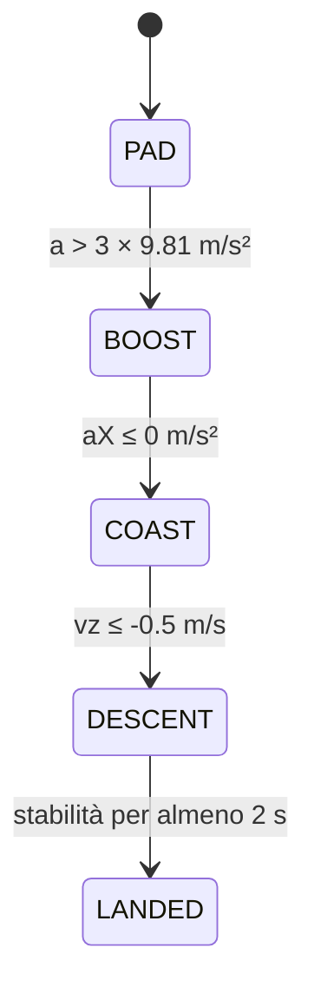
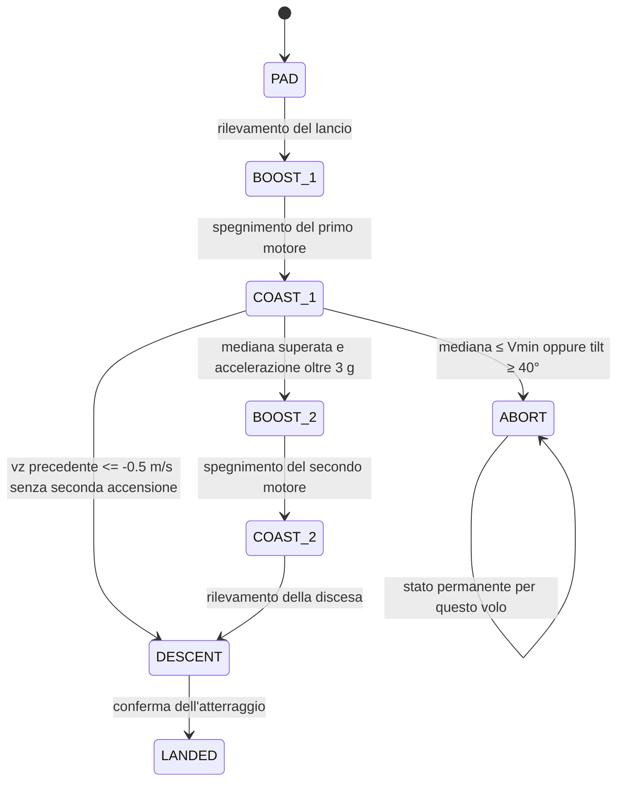

# Macchine a stati e funzioni di transizione

La macchina normale e quella bistadio sono implementate nel firmware e condividono
navigazione, regole, registrazione e gestione delle uscite. Questo documento descrive
le transizioni correnti; i limiti di qualificazione fisica restano in Validation.

## 1. Convenzioni

- `δ(stato, ingressi, memoria)` indica la funzione di transizione.
- Se nessuna condizione di transizione è soddisfatta, si mantiene lo stato corrente.
- `a`: modulo dell'accelerazione specifica misurata dall'accelerometro, in m/s².
- `aX`: accelerazione specifica lungo BODY X, in m/s². BODY X punta verso la punta
  del razzo, dopo la trasformazione dell'orientamento della scheda. Non è
  l'accelerazione verticale già compensata per la gravità.
- `vz`: velocità verticale stimata, con segno positivo verso l'alto, in m/s.
- `θ`: angolo tra l'asse longitudinale del razzo e la verticale verso l'alto.
- Un campione valido è fresco, distinto dai precedenti e numericamente valido;
  leggere più volte lo stesso campione non aumenta il conteggio.

## 2. Macchina di volo normale — implementata



### Funzione di transizione

| Stato corrente | Condizione | Stato successivo |
|---|---|---|
| PAD | `a > 3 × 9.81 m/s²` | BOOST |
| BOOST | `aX ≤ 0 m/s²` | COAST |
| COAST | `vz ≤ -0.5 m/s` | DESCENT |
| DESCENT | Conferma dell'atterraggio descritta sotto | LANDED |
| LANDED | Qualsiasi ingresso durante lo stesso volo | LANDED |

La transizione BOOST → COAST attuale usa un singolo campione valido: non ha una
finestra di conferma. Nel codice attuale il detector riceve `vz` dal ciclo
precedente, prima della predizione e della correzione Kalman del ciclo corrente.

### Conferma dell'atterraggio

In DESCENT il detector richiede:

- `abs(a - 9.81) < 2 m/s²`;
- modulo della velocità angolare `< 0.5 rad/s`;
- intervallo tra quota barometrica minima e massima `< 1 m` nella finestra;
- almeno `2 s` di stabilità, con una nuova misura barometrica valida per
  confermare la transizione.

Se i controlli di stabilità falliscono, la finestra viene azzerata. I cicli senza
una nuova quota barometrica possono far avanzare il tempo di una finestra già
aperta, ma non confermano da soli LANDED. Ingressi non finiti o `dt` fuori
dall'intervallo `(0, 0.1 s]` non fanno avanzare lo stato e azzerano la finestra.

Il controllo giroscopico di atterraggio appartiene alla macchina normale già
esistente. La rimozione del controllo sulla velocità angolare dal design bistadio
non rimuove questo controllo di atterraggio.

Riferimenti: [FlightDetector.cpp](../../src/navigation/FlightDetector.cpp),
[Navigation.cpp](../../src/navigation/Navigation.cpp),
[documentazione navigazione](NAVIGATION.md).

## 3. Macchina di volo bistadio — implementata



I nomi con underscore nel diagramma rappresentano le etichette dell'interfaccia
BOOST 1, COAST 1, BOOST 2 e COAST 2.

### Parametri e memoria della macchina

| Elemento | Valore o significato |
|---|---|
| Selettore | Macchina normale oppure bistadio |
| `Vmin` | Velocità verticale minima configurata dall'utente, in m/s |
| `N` | **8 campioni validi** di velocità verticale |
| Limite di inclinazione | **40°**, esclusi: il tilt deve essere `< 40°` |
| Controllo della velocità angolare per ABORT | **Assente** |
| Finestra velocità | Primi 8 campioni validi a partire dall'ingresso in COAST 1 |
| Esito velocità | In attesa, superato oppure fallito |
| ABORT | Bloccato fino alla conclusione della sessione di volo |

### BOOST 1 → COAST 1: controllo della velocità

Il rilevamento dello spegnimento del primo motore apre una sola finestra di
raccolta, il più vicino possibile alla transizione BOOST 1 → COAST 1:

1. Azzerare il buffer e il conteggio della finestra.
2. Raccogliere i primi **8 campioni validi e distinti** di `vz` a partire
   dall'ingresso in COAST 1. Non includere misure precedenti allo spegnimento.
3. Ordinare i valori: `v[0] ≤ … ≤ v[7]`.
4. Calcolare `mediana = (v[3] + v[4]) / 2`.
5. Se `mediana > Vmin`, il controllo è superato.
6. Se `mediana ≤ Vmin`, passare in ABORT.

È una finestra iniziale finita, non una finestra mobile controllata per tutto
COAST 1. Non si richiedono otto misure tutte sotto soglia e non si usa la media
degli otto valori: la scelta concordata è la **mediana**.

Fino all'esito del controllo, le attivazioni del secondo stadio restano in attesa.
Il superamento della velocità non comanda automaticamente un'uscita: rende
possibile proseguire, rispettando anche tilt, regole e condizioni applicabili.

Il tempo tra il primo e l'ottavo campione è circa `7 / frequenza`: ad esempio
70 ms a 100 Hz o 35 ms a 200 Hz, oltre all'eventuale attesa del primo campione.
Sono esempi, non una garanzia sulla frequenza effettiva della scheda.

### COAST 1: controllo continuo dell'inclinazione

Per **tutta COAST 1**, compresa la raccolta degli otto campioni:

```text
θ < 40°   → orientamento consentito
θ ≥ 40°   → ABORT
```

Il controllo riguarda un cono di 40° attorno alla verticale in qualsiasi
direzione: non è una tolleranza indipendente di ±40° su due angoli di Eulero.
La rotazione attorno all'asse longitudinale, da sola, non è un superamento del tilt.

Il tilt deve essere ricavato dall'assetto stimato e dall'asse longitudinale
correttamente orientato. Una formulazione è:

```text
θ = acos(clamp(dot(asse_longitudinale_unitario, verticale_unitaria), -1, 1))
```

I due vettori devono essere espressi nello stesso riferimento. L'inizializzazione
dell'assetto deve essere coerente con la verticale reale; la sola scelta dell'asse
di montaggio non garantisce questa inizializzazione.

Non è stata concordata una persistenza di più campioni per il tilt: nel design
attuale il superamento su una stima valida causa ABORT immediato.

### Priorità e funzione di transizione in COAST 1

```text
prima della predizione/correzione della velocita del ciclo:
    se il tilt valido e >= 40 gradi: ABORT
    altrimenti, se vz precedente <= -0.5 m/s: DESCENT
    altrimenti, se la mediana e superata e a > 3 * 9.81 m/s^2: BOOST 2
    altrimenti: COAST 1

dopo la predizione/correzione della velocita del ciclo:
    se siamo ancora in COAST 1 e mancano campioni:
        aggiungi il nuovo vz valido alla finestra
        all'ottavo campione calcola la mediana
        se mediana <= Vmin: ABORT
        altrimenti abilita le nuove attivazioni

solo dopo questi controlli:
    valuta le regole e le attivazioni consentite
```

ABORT ha priorità su una possibile transizione a BOOST 2 e sull'esecuzione delle
uscite nello stesso ciclo. Il controllo non deve arrivare dopo l'attivazione
che avrebbe dovuto impedire.

### Comportamento di ABORT

- Nessun ritorno a COAST 1, BOOST 2 o agli altri stati di volo nella stessa sessione.
- Annullamento delle attivazioni delle uscite ancora in attesa.
- Blocco di tutte le nuove attivazioni delle uscite, anche se una regola diventa vera.
- Acquisizione dei sensori e registrazione continuano.
- Il CSV salva lo stato ABORT e il motivo (`abort_reason`: 1 velocità, 2 tilt);
  il JSON esporta il primo istante/motivo e i parametri della macchina usata.
  Mediana e tilt correnti sono anche disponibili nello stato della simulazione.

Le uscite gia attive completano la loro azione: gli impulsi pyro gia alti
arrivano alla scadenza, quelli ancora in attesa/settling sono cancellati. Un servo
che ha ricevuto il comando mantiene il PWM; non esiste feedback meccanico di fine
movimento. La chiusura della sessione o un disarmo esplicito interrompono le uscite.
I canali riservati agli [aerofreni](AIRBRAKES.md) seguono la chiusura continua allo 0%
in ABORT; al disarmo restano chiusi con PWM mantenuto fino al rilascio esplicito.
La descrizione di completamento sopra riguarda le uscite delle regole ordinarie.
Il comando di disarmo e consentito anche in ABORT; non fa uscire la stessa macchina
verso altri stati di volo e non cancella il log.

### Transizioni e casi limite implementati

| Transizione o caso | Comportamento |
|---|---|
| PAD -> BOOST 1 | Modulo accelerazione > 3 * 9.81 m/s^2 per 3 campioni IMU freschi consecutivi |
| BOOST 1 -> COAST 1 | aX <= 0; apre la finestra di 8 campioni |
| COAST 1 -> BOOST 2 | Mediana > Vmin, tilt < 40 gradi e modulo accelerazione > 3 * 9.81 m/s^2 |
| BOOST 2 -> COAST 2 | aX <= 0 |
| COAST 2 -> DESCENT -> LANDED | Criteri della macchina normale |
| Discesa in COAST 1 senza seconda accensione | DESCENT quando vz precedente <= -0.5 m/s; non e un nuovo motivo di ABORT |
| Passaggio diretto COAST 1 -> DESCENT | Cancella le attivazioni pendenti del run, ma consente nuove regole di recupero in DESCENT |
| Campioni invalidi o finestra incompleta | Non contano; le nuove attivazioni restano inibite. Nessun timeout arbitrario e introdotto |
| Tilt | Assetto inizializzato da un campione PAD valido vicino a 1 g nella modalita bistadio; controllo sull'asse longitudinale, non sul modulo gyro |

L'assetto iniziale e la qualita delle stime richiedono ancora verifica con i sensori
reali riparati. I test host dimostrano le funzioni e il comportamento simulato,
non qualificano la soglia per un lancio reale.

## 4. Selezione, persistenza e simulazione

- `config machine` legge selezione, soglia e `machine_ready`.
- `config machine normal` salva la macchina normale.
- `config machine bistage <Vmin>` salva il bistadio; soglia finita tra 0 e 100000 m/s.
- L'app usa Salva macchina a stati e conferma la rilettura dalla scheda.
- Le modifiche richiedono stato disarmato/idle e nessuna bozza di regole attiva.
- Selezione e soglia sono congelate all'avvio del run; il firmware impedisce modifiche durante arming/volo.
- Il ripristino di fabbrica cancella il record della macchina: il valore di default e **normale/bistadio disattivato**.
- Il record e separato da regole e orientamento; la formattazione dei voli non lo cancella.
- I parametri usati vengono congelati nell'header del volo, non riletti dalle impostazioni attuali durante l'esportazione.

La modalita normale continua a usare Hoppino nel test integrato. In bistadio il
firmware sceglie automaticamente un profilo sintetico da 25 secondi a 200 Hz,
con primo BOOST tra 5 e 6 secondi, COAST 1 tra 6 e 7, secondo BOOST tra 7 e 8,
poi coast/discesa/atterraggio. I sensori sintetici entrano nella stessa pipeline
usata dal volo: non vengono assegnate fasi o stime preconfezionate al detector.
Uscite fisiche/virtuali e registrazione restano scelte indipendenti.

## 5. Ciclo di armamento — macchina separata, implementata

Le fasi di volo non vanno confuse con il ciclo operativo di `ArmingController`:

| Stato corrente | Evento/condizione | Stato successivo |
|---|---|---|
| DISARMED | Richiesta ARM fisica, parametri e preflight validi | ARMING |
| DISARMED | Avvio simulazione con controlli validi e runtime avviato | ARMED, senza calibrazione fisica |
| ARMING | Calibrazione completata, nuovo preflight valido e avvio runtime riuscito | ARMED |
| ARMING | Cancellazione o errore | DISARMED, oppure CLOSING se resta lavoro di registrazione |
| ARMED | Disarmo consentito, arresto o fine runtime | DISARMED, oppure CLOSING durante la chiusura della registrazione |
| CLOSING | Chiusura della registrazione completata | DISARMED |

Il normale comando di disarmo durante un volo attivo è consentito in PAD o
LANDED e in ABORT; nelle altre fasi attuali viene rifiutato. Gli arresti di sviluppo e gli
errori seguono percorsi distinti. Il disarmo in ABORT chiude la sessione e conserva il log dell'aborto.

**Servo preparato non significa ARMED.** La preparazione mantiene il PWM iniziale
mentre la scheda resta DISARMED. Il pulsante Rilascia servo è separato dal pulsante
ARM/DISARM; l'avvio della simulazione virtuale rilascia la preparazione.

Riferimenti: [ArmingController.cpp](../../src/flight/ArmingController.cpp),
[SimulationSession.cpp](../../src/simulation/SimulationSession.cpp),
[architettura](ARCHITECTURE.md).

La conferma PAD -> BOOST si azzera sotto soglia, con un frame invalido/duplicato,
una sequenza IMU interrotta o un intervallo superiore a due periodi nominali.
BOOST 2 conserva il criterio precedente; la finestra di 8 velocita in COAST resta indipendente.

BOOST -> COAST e BOOST 2 -> COAST 2 richiedono tre campioni IMU freschi
consecutivi con accelerazione assiale bodyX <= 0. Un valore positivo o
una interruzione/invalidita dei dati azzera la conferma, come per PAD -> BOOST.
